

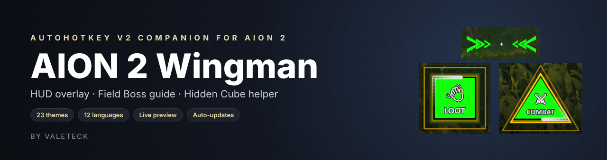

### ⚡ Fast Teleport Assistant for every Field Boss · 🎯 HUD overlay · 🛡️ No injection, no bot, no telemetry

**A quality-of-life (QoL) companion for AION 2: fewer menus and clicks, more time playing.**

**💚 100% free · no paid features · no hidden features · donations are entirely optional**

[**⬇ Download the latest release**](../../releases/latest) · 💖 Donate: [**PayPal**](https://www.paypal.com/paypalme/valeteck) · [**Ko-fi**](https://ko-fi.com/VaLeTecK)

📦 **First time?** Extract the zip and double-click **`FIRST RUN QUICK-SETUP.bat`**: it installs everything and sets Wingman up for you.

 

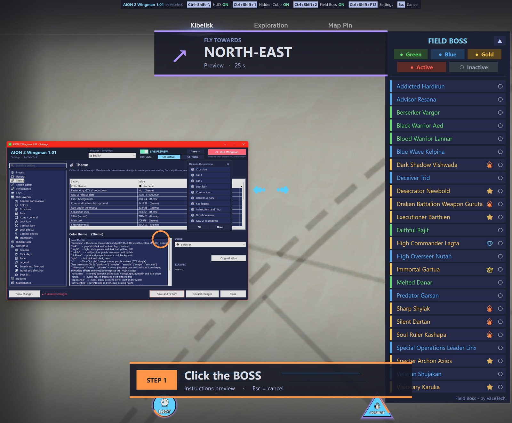

🇬🇧 [English](#-english) · 🇮🇹 [Italiano](#-italiano) · 🇪🇸 [Español](#-español) · 🇫🇷 [Français](#-français) · 🇩🇪 [Deutsch](#-deutsch) · 🇧🇷 [Português](#-português) · 🇷🇺 [Русский](#-русский) · 🇰🇷 [한국어](#-한국어) · 🇨🇳 [简体中文](#-简体中文) · 🇯🇵 [日本語](#-日本語)

---

## 🇬🇧 English

**AION 2 Wingman** is a Windows program written in **AutoHotkey v2** that runs next to AION 2 and gives you a clearer HUD and a few smart helpers. It's a **quality-of-life (QoL)** tool: fewer menus, fewer clicks, more time actually playing.

### 🛡️ Safe by design

AION 2 Wingman is a plain **AutoHotkey v2** script: you can open it with Notepad and read every single line.

- ❌ **No injection**: it never touches the game process, its memory or its files, and it loads nothing into the game.
- ❌ **No packet reading, no bot**: it doesn't read or change network traffic and never plays for you.
- 👀 **It only looks at the screen, like you do**: map screenshots are read by the built-in Windows OCR, locally on your PC.
- 🖱️ **Every click is yours**: it moves the cursor to the right spot and, on the map, uses the mouse wheel to scroll the boss list and zoom out. The only automatic click (Hidden Cube) is **off by default**.
- 🔒 **No telemetry, no data collection**: it sends no game or personal data anywhere. Its only connection is the update check on this GitHub page, which you can turn off (Settings > Updates).
- 🗂️ **Everything stays on your PC**: your settings are saved in `%AppData%\AION 2 Wingman`.
- 🧪 **Scanned on VirusTotal**: every release has its VirusTotal scan linked in the release notes.
- 💚 **100% free, forever**: no paid features, no hidden features, no ads, no account. Donations are entirely up to you and unlock nothing.

> ⚠️ Wingman is an unofficial third-party tool. Nobody can promise that an external program is 100% risk-free under a game's rules and anti-cheat, so use it consciously and within the game's terms of service.

### ⚡ Star feature: the Fast Teleport Assistant for every Field Boss

**From the map to the boss in 3 moves** (ULTRA-FAST MODE, the default):

1. **Click the boss** in the Field Boss panel (open the map with `M`).
2. **Click the Teleport**: Wingman has already found the boss's Teleport in the Kibelisk list on the left, scrolled to it and put the cursor on it.
3. **Press `F` twice** and follow the arrow with the **flight direction** to the boss.

**NORMAL MODE**, the full guided route, is still one click away in the Settings:

Reaching a Field Boss normally means opening the map, going to Exploration and then Field Boss, finding the boss in a long list, looking for the nearest Teleport and flying in the right direction. **Wingman turns all of this into a few guided clicks:**

1. **Open the map** (`M`): the Field Boss panel lists every boss A–Z, with grade, status (active / inactive) and importance.
2. **Click a boss** in the panel.
3. Wingman **moves the cursor step by step** to *Exploration*, *Field Boss*, *the boss* and then **the nearest Teleport**, which it finds by itself on the map. A big on-screen instruction and a ring on the exact spot tell you what to click, and the cursor can stay locked there so you can't miss.
4. **Press `F`** (Travel): an arrow shows the **flight direction** to the boss, for example *NORTH-EAST*.
5. `Esc` cancels at any time. Inside dungeons the panel stays hidden.

⚡ **Built for speed.** Once you've picked the boss there's nothing to aim at or read: just **keep spamming left click**. At every step the cursor is already on the right spot, and stray clicks between steps are blocked. As soon as the Teleport is clicked, **spam `F`**: the mouse stays locked for a few seconds, so no misclick can get in the way of your departure.

🚀 **ULTRA-FAST MODE in detail.** Wingman scrolls the Kibelisk list by itself until it finds the Teleport. The flight direction is already set for most bosses, otherwise it's worked out from the boss icon nearest to the Teleport, and you can change it per boss in the boss list. Switch mode in *Settings > Field Boss > Search and Teleport*; the Home page shows which one is in use.

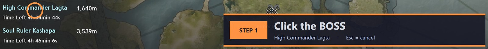
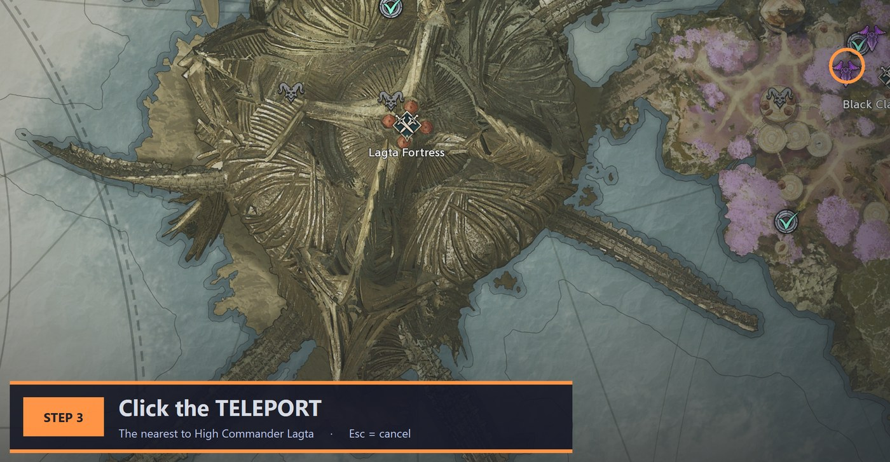

### ✨ Features

**🎯 HUD overlay**
- Crosshair, two bars and two status icons, **LOOT** and **COMBAT**, that light up from your macros' signals (F9 = combat, F10 = loot).
- Each icon has its own shape, size, position, text, emoji, animated effects (pulse, ring, spin, glow) and fade-in/out. It can mirror the other icon automatically.
- Text and emoji fit inside the icon shape by themselves.

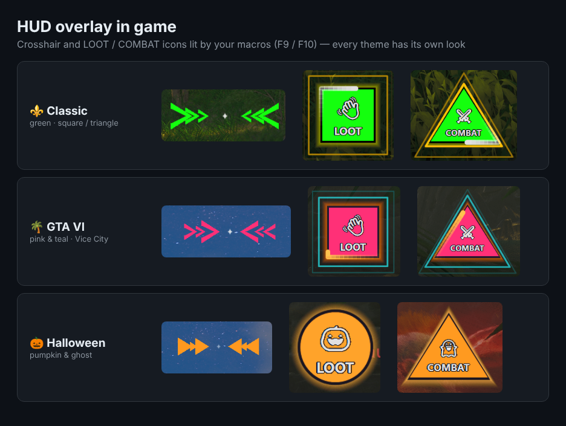

**👑 Field Boss**
- When you open the map, a panel lists every field boss (A–Z) with grade colors, active / inactive status and filters.
- Click a boss and a **step-by-step guide** moves the cursor to Exploration, Field Boss, the boss and the nearest Teleport. Big on-screen instructions tell you what to click.
- After Travel, an arrow shows the **flight direction** to the boss.
- Inside **dungeons** the panel stays hidden: it is detected from the map tabs and from the dungeon name.
- Uses the Windows OCR, so it reads the English game client.

🖼️ Field Boss panel in three themes

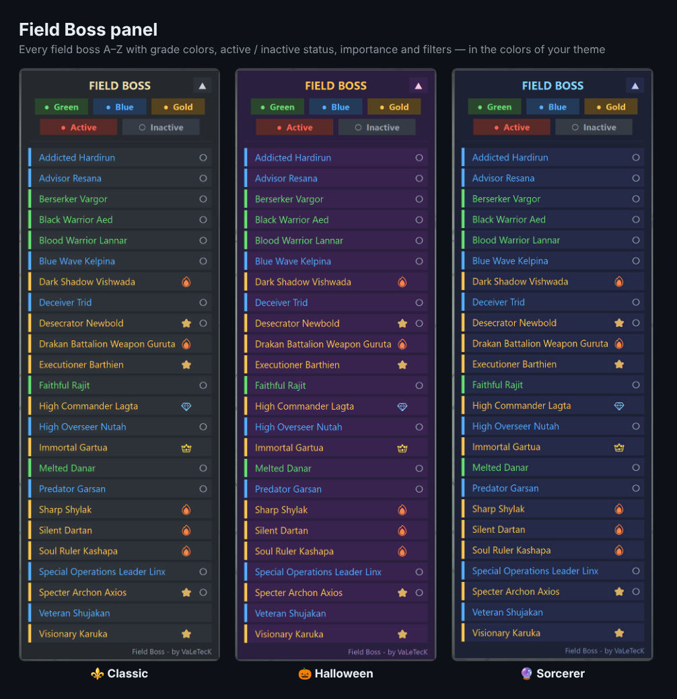

**🧊 Hidden Cube**
- When the Hidden Cube window opens, it moves the mouse to "Open with Key" and keeps it there.

**⚙️ Settings window** (Ctrl+Shift+F12)
- A **Home page** to turn each feature on and off with one click, plus shortcuts to presets, theme, keys and updates.
- **Basic mode** (only the essential options, no technical names) and **Advanced mode** (every customization option), switchable at the top.
- Closes by itself when you close AION 2 (can be turned off).
- A menu for every function, a **search box**, a description and an example for each option, and a **live preview** of the HUD without the game.
- **Resolution presets**: FullHD, 2K and 4K.
- **Performance profiles**, from "potato" to "gigachad".
- Your own presets.
- A Maintenance menu and a clear **Quit Wingman** button.
- **12 languages**: English, Italiano, Español, Français, Deutsch, Português, Русский, 한국어, 简体中文, 日本語, plus two bonus meme languages.

**🎨 Themes**
- **22 ready-made themes**:
  - classics: dark, bright, cuddle, pinkhaze, e-girl and a GTA VI one with a release countdown;
  - **8 AION 2 class themes**, each with its own crosshair and icon shapes, animations, effects and emoji;
  - **7 event themes**: Halloween, Christmas, New Year, Valentine's Day, Carnival, Easter and St. Patrick's Day.
- **Theme editor**: press *Customize this theme* and you get your own copy ("… Custom"), editable in every detail. Ready-made themes never change.

🎨 See all the themes

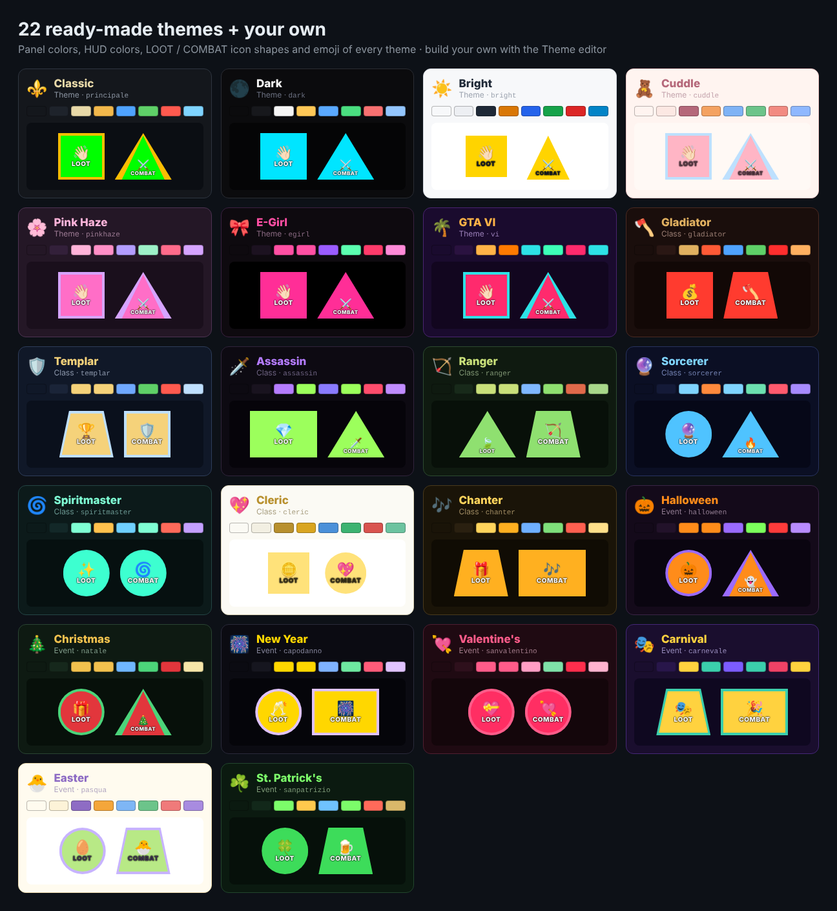

**🔄 Updates and personal settings**
- Checks this repository for new releases and installs them when you agree, or automatically. It never interrupts you while you play.
- Your settings, presets and themes are stored in `%AppData%\AION 2 Wingman` and **survive every update**.

### 🎛️ Customize everything

Every single element of the HUD and of the tools can be tuned to your taste, in **look** and in **behavior**: more than 240 options, each with a description, an example and the live preview, without touching the code.

- **Crosshair**: shape (arrow, triangle, bar, diamond, circle, block, separate for ON and OFF), number of arrows, size, thickness, spacing, gap, animation (pulse, march, sequence) and speed.
- **Bars**: width, height, border, position, center gap and slant, each bar on its own.
- **LOOT and COMBAT icons**: shape, size, border, position (or mirrored), top and bottom text, emoji, text colors, effects (pulse, ring, spin, glow) with duration, color and intensity, fade in and out, each icon on its own.
- **Colors and transitions**: active and idle colors, fade and color-blend times for every element.
- **Field Boss and Assisted Teleport**: panel size and position, filters, full boss list editor (name, grade, importance, Teleport, direction), key legend, guide behavior (mouse lock, click block, instruction size and position, mouse lock after the Teleport), flight-direction arrow (duration, delay, size), Teleport search and zoom, dungeon list.
- **Hidden Cube**: position, mouse lock, intervals, optional auto-click.
- **Keys**: every key can be changed.
- **The whole app**: 22 themes plus the Theme editor, 12 languages, performance profiles, resolution presets and your own presets.

### 💻 Requirements
- Windows 10 or 11
- AutoHotkey v2 and the English Windows OCR (both installed by the FIRST RUN QUICK-SETUP)
- English AION 2 client (for Field Boss)

### 🚀 Installation and first launch: start from the FIRST RUN QUICK-SETUP

> **After extracting the zip, double-click `FIRST RUN QUICK-SETUP.bat` first.**
> It's the file with "QUICK-SETUP" in its name, in the main folder of the package.
>
> The FIRST RUN QUICK-SETUP installs everything Wingman needs to work 100% (AutoHotkey v2, the Windows OCR, the OCR library) and walks you through a quick first configuration: language, screen resolution, performance, color theme, features ON/OFF and keyboard. At the end it creates a desktop shortcut and starts Wingman with your settings already in place.

1. Download **`AION-2-Wingman.zip`** from the [latest release](../../releases/latest).
2. Right-click the zip > **Properties** > tick **Unblock** > OK. This avoids Windows warnings.
3. Extract it to a **permanent folder**, for example `Documents\AION 2 Wingman`. Don't run it from inside the zip.
4. Double-click **`FIRST RUN QUICK-SETUP.bat`** and accept the administrator prompt. If you see "Windows protected your PC", click *More info* > *Run anyway*.
5. Follow the guided setup. Pressing Enter always picks the recommended choice.
6. From then on, start Wingman from the desktop shortcut or with **`AION 2 Wingman.ahk`**. You can run the FIRST RUN QUICK-SETUP again at any time from *Settings > 🛠️ Maintenance*.

| In the package | What it is |
|---|---|
| 📦 **`FIRST RUN QUICK-SETUP.bat`** | **Start here**: first-time setup |
| `AION 2 Wingman.ahk` | the program |
| `OCR.ahk` | OCR library (used by Field Boss) |
| `README\` · `INFOGRAPHICS\` | guides in 10 languages |

### 📖 Quick guide

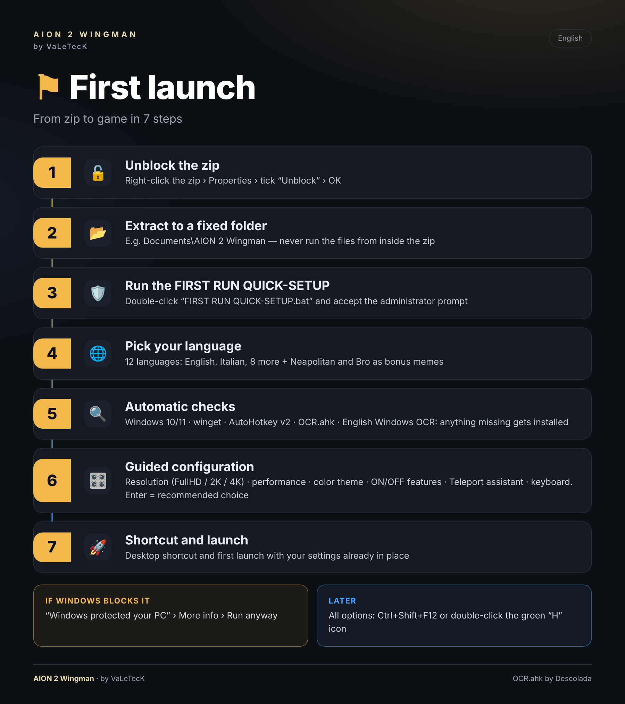 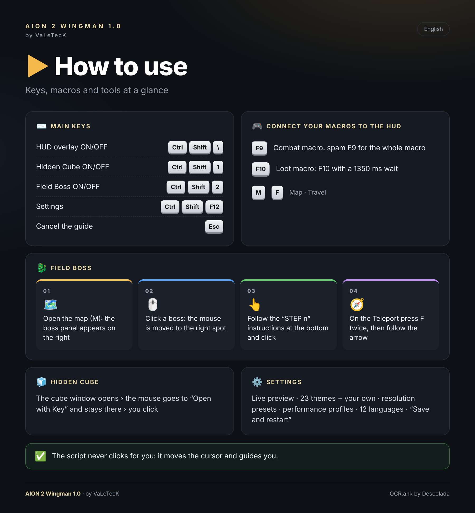

### ⌨️ Default keys
| Keys | Action |
|---|---|
| `Ctrl+Shift+\` | HUD overlay ON/OFF |
| `Ctrl+Shift+1` | Hidden Cube ON/OFF |
| `Ctrl+Shift+2` | Field Boss ON/OFF |
| `Ctrl+Shift+F12` | Settings (also outside the game) |
| `Esc` | Cancel the Field Boss guide |
| `M` / `F` | Game Map / Travel keys (Wingman listens to them) |
| `F9` / `F10` | Macro signals for the HUD |

All keys can be changed in Settings > Keys.

### 🎮 Connect your macros to the HUD
- **Combat macro**: spam `F9` for the whole macro.
- **Loot macro**: add `F10` with a 1350 ms wait.

The keys still reach the game as usual.

### ❓ FAQ
- **Nothing happens in game:** Wingman works only while `AION2.exe` is in the foreground. Check the green "H" icon in the taskbar.
- **Field Boss "not available":** `OCR.ahk` or the English Windows OCR is missing. Run the FIRST RUN QUICK-SETUP again.
- **HUD too big or too small:** apply the right resolution preset in Settings.
- **Antivirus warning:** this is a common false positive with AutoHotkey scripts. Add the folder to the exclusions.

---

## 🇮🇹 Italiano

**AION 2 Wingman** è un programma per Windows scritto in **AutoHotkey v2**. Gira accanto ad AION 2 e ti dà un HUD più chiaro e qualche aiuto intelligente. È uno strumento di **qualità della vita (QoL)**: meno menu, meno click, più tempo per giocare davvero.

### 🛡️ Sicuro per come è fatto

AION 2 Wingman è un semplice script **AutoHotkey v2**: puoi aprirlo con il Blocco note e leggerne ogni singola riga.

- ❌ **Nessuna injection**: non tocca mai il processo del gioco, la sua memoria o i suoi file, e non carica niente dentro il gioco.
- ❌ **Nessuna lettura dei pacchetti, nessun bot**: non legge e non modifica il traffico di rete e non gioca mai al posto tuo.
- 👀 **Guarda solo lo schermo, come fai tu**: gli screenshot della mappa vengono letti dall'OCR integrato di Windows, in locale sul tuo PC.
- 🖱️ **Ogni click è tuo**: porta il cursore sul punto giusto e, sulla mappa, usa la rotellina del mouse per scorrere la lista dei boss e fare zoom indietro. L'unico click automatico (Hidden Cube) è **spento di default**.
- 🔒 **Nessuna telemetria, nessuna raccolta di dati**: non invia da nessuna parte dati del gioco o personali. L'unica connessione è il controllo aggiornamenti su questa pagina GitHub, che puoi disattivare (Impostazioni > Aggiornamenti).
- 🗂️ **Tutto resta sul tuo PC**: le impostazioni sono salvate in `%AppData%\AION 2 Wingman`.
- 🧪 **Controllato su VirusTotal**: ogni release ha la sua scansione VirusTotal collegata nelle note della release.
- 💚 **Gratuito al 100%, per sempre**: nessuna funzione a pagamento, nessuna funzione nascosta, niente pubblicità, nessun account. Le donazioni sono del tutto a tua scelta e non sbloccano nulla.

> ⚠️ Wingman è uno strumento di terze parti non ufficiale. Nessuno può promettere che un programma esterno sia a rischio zero rispetto alle regole e all'anti-cheat di un gioco: usalo consapevolmente e nel rispetto dei termini di servizio del gioco.

### ⚡ La funzione di punta: l'Assistente Teleport veloce per ogni Field Boss

**Dalla mappa al boss in 3 mosse** (ULTRA-FAST MODE, quella predefinita):

1. **Clicca il boss** nel pannello Field Boss (apri la mappa con `M`).
2. **Clicca il Teleport**: Wingman ha già trovato il Teleport del boss nella lista Kibelisk a sinistra, ci ha scrollato sopra e ci ha portato il cursore.
3. **Premi `F` due volte** e segui la freccia con la **direzione di volo** verso il boss.

La **NORMAL MODE**, il percorso guidato completo, resta a un click di distanza nelle Impostazioni:

Di solito per raggiungere un Field Boss devi aprire la mappa, andare in Exploration e poi in Field Boss, cercare il boss in una lunga lista, trovare il Teleport più vicino e volare nella direzione giusta. **Wingman trasforma tutto questo in pochi click guidati:**

1. **Apri la mappa** (`M`): il pannello Field Boss elenca tutti i boss dalla A alla Z, con grado, stato (attivo / non attivo) e importanza.
2. **Clicca un boss** nel pannello.
3. Wingman **porta il cursore passo dopo passo** su *Exploration*, *Field Boss*, *il boss* e poi **il Teleport più vicino**, che trova da solo sulla mappa. Un'istruzione grande a schermo e un anello sul punto esatto ti dicono cosa cliccare, e il cursore può restare bloccato lì così non sbagli.
4. **Premi `F`** (Travel): una freccia indica la **direzione di volo** verso il boss, per esempio *NORD-EST*.
5. `Esc` annulla in qualsiasi momento. Nei dungeon il pannello resta nascosto.

⚡ **Pensato per la velocità.** Scelto il boss non devi mirare né leggere niente: **spamma il click sinistro**. A ogni fase il cursore è già sul punto giusto e i click fuori tempo tra una fase e l'altra vengono bloccati. Appena hai cliccato il Teleport, **spamma `F`**: il mouse resta bloccato per qualche secondo, così nessun click sbagliato può rovinarti la partenza.

🚀 **ULTRA-FAST MODE nel dettaglio.** Wingman scorre da solo la lista Kibelisk finché non trova il Teleport. La direzione di volo è già impostata per quasi tutti i boss, altrimenti si calcola dall'icona del boss più vicina al Teleport, e puoi cambiarla per ogni boss nell'elenco boss. La modalità si cambia in *Impostazioni > Field Boss > Ricerca e Teleport*; la Home mostra quella in uso.

### ✨ Funzioni

**🎯 HUD overlay**
- Mirino, due barre e due icone di stato, **LOOT** e **COMBAT**, che si accendono con i segnali delle tue macro (F9 = combat, F10 = loot).
- Ogni icona ha forma, grandezza, posizione, testi, emoji, effetti animati (pulse, ring, spin, glow) e dissolvenze propri. Può anche essere speculare all'altra.
- Testi ed emoji si adattano da soli alla forma dell'icona.

**👑 Field Boss**
- Aprendo la mappa compare un pannello con tutti i field boss (A–Z), colori del grado, stato attivo / non attivo e filtri.
- Clicchi un boss e una **guida a fasi** porta il cursore su Exploration, Field Boss, il boss e il Teleport più vicino. Istruzioni grandi a schermo ti dicono cosa cliccare.
- Dopo il Travel, una freccia indica la **direzione di volo** verso il boss.
- Nei **dungeon** il pannello resta nascosto: li riconosce dai tab della mappa e dal nome del dungeon.
- Usa l'OCR di Windows, quindi legge il client del gioco in inglese.

🖼️ Il pannello Field Boss in tre temi

**🧊 Hidden Cube**
- Quando si apre la finestra degli Hidden Cube porta il mouse su "Open with Key" e ce lo tiene.

**⚙️ Finestra Impostazioni** (Ctrl+Shift+F12)
- Una pagina **Home** per accendere e spegnere ogni funzione con un click, con scorciatoie a preset, tema, tasti e aggiornamenti.
- Modalità **Base** (solo le opzioni essenziali, senza nomi tecnici) e **Avanzata** (tutte le opzioni di personalizzazione), da scegliere in alto.
- Si chiude da sola quando chiudi AION 2 (disattivabile).
- Un menu per ogni funzione, una **casella di ricerca**, descrizione ed esempio per ogni opzione e l'**anteprima dal vivo** dell'HUD anche senza gioco.
- **Preset di risoluzione**: FullHD, 2K e 4K.
- **Profili prestazioni**, da "potato" a "gigachad".
- Preset tuoi.
- Un menu Manutenzione e un pulsante **Termina Wingman** ben chiaro.
- **12 lingue**: English, Italiano, Español, Français, Deutsch, Português, Русский, 한국어, 简体中文, 日本語, più due lingue bonus meme.

**🎨 Temi**
- **22 temi pronti**:
  - classici: dark, bright, cuddle, pinkhaze, e-girl e uno GTA VI con il conto alla rovescia all'uscita;
  - **8 temi delle classi di AION 2**, ognuno con forme di mirino e icone, animazioni, effetti ed emoji propri;
  - **7 temi di eventi**: Halloween, Natale, Capodanno, San Valentino, Carnevale, Pasqua e San Patrizio.
- **Editor temi**: premi *Personalizza questo tema* e ottieni una tua copia ("… Custom"), modificabile in ogni dettaglio. I temi pronti non cambiano mai.

🎨 Guarda tutti i temi

**🔄 Aggiornamenti e impostazioni personali**
- Controlla le nuove release di questa repository e le installa quando sei d'accordo, oppure in automatico. Non ti interrompe mai mentre giochi.
- Impostazioni, preset e temi sono salvati in `%AppData%\AION 2 Wingman` e **restano dopo ogni aggiornamento**.

### 🎛️ Personalizza ogni cosa

Ogni singolo elemento dell'HUD e dei tool si regola come vuoi, sia nell'**aspetto** sia nel **funzionamento**: più di 240 opzioni, ognuna con descrizione, esempio e anteprima dal vivo, senza toccare il codice.

- **Mirino**: forma (freccia, triangolo, barra, rombo, cerchio, blocco, diversa per ON e OFF), numero di frecce, grandezza, spessore, spaziatura, distanza, animazione (pulse, march, sequence) e velocità.
- **Barre**: larghezza, altezza, cornice, posizione, spazio centrale e inclinazione, ogni barra per conto suo.
- **Icone LOOT e COMBAT**: forma, grandezza, cornice, posizione (o speculare), testo in alto e in basso, emoji, colori dei testi, effetti (pulse, ring, spin, glow) con durata, colore e intensità, dissolvenze, ogni icona per conto suo.
- **Colori e transizioni**: colori attivi e inattivi, tempi di dissolvenza e sfumatura per ogni elemento.
- **Field Boss e Teleport assistito**: grandezza e posizione del pannello, filtri, editor completo della lista dei boss (nome, grado, importanza, Teleport, direzione), legenda dei tasti, comportamento della guida (blocco del mouse, blocco dei click, grandezza e posizione delle istruzioni, blocco del mouse dopo il Teleport), freccia della direzione (durata, ritardo, grandezza), ricerca del Teleport e zoom, lista dei dungeon.
- **Hidden Cube**: posizione, blocco del mouse, intervalli, click automatico facoltativo.
- **Tasti**: ogni tasto si può cambiare.
- **Tutta l'app**: 22 temi più l'Editor temi, 12 lingue, profili prestazioni, preset di risoluzione e preset tuoi.

### 💻 Requisiti
- Windows 10 o 11
- AutoHotkey v2 e l'OCR inglese di Windows (li installa il FIRST RUN QUICK-SETUP)
- Client di AION 2 in inglese (per il Field Boss)

### 🚀 Installazione e primo avvio: si parte dal FIRST RUN QUICK-SETUP

> **Dopo aver estratto lo zip, avvia per primo `FIRST RUN QUICK-SETUP.bat` con un doppio click.**
> È il file con "QUICK-SETUP" nel nome, nella cartella principale del pacchetto.
>
> Il FIRST RUN QUICK-SETUP installa tutto quello che serve a Wingman per funzionare al 100% (AutoHotkey v2, l'OCR di Windows, la libreria OCR) e ti guida in una breve configurazione iniziale: lingua, risoluzione dello schermo, prestazioni, tema dei colori, funzioni ON/OFF e tastiera. Alla fine crea il collegamento sul desktop e avvia Wingman con le tue impostazioni già pronte.

1. Scarica **`AION-2-Wingman.zip`** dall'[ultima release](../../releases/latest).
2. Tasto destro sullo zip > **Proprietà** > spunta **Annulla blocco** > OK. Così eviti gli avvisi di Windows.
3. Estrailo in una **cartella fissa**, ad esempio `Documenti\AION 2 Wingman`. Non avviarlo da dentro lo zip.
4. Doppio click su **`FIRST RUN QUICK-SETUP.bat`** e accetta la richiesta di amministratore. Se compare "Windows ha protetto il PC", clicca *Ulteriori informazioni* > *Esegui comunque*.
5. Segui la configurazione guidata. Premendo Invio scegli sempre l'opzione consigliata.
6. Da lì in poi avvia Wingman dal collegamento sul desktop o con **`AION 2 Wingman.ahk`**. Il FIRST RUN QUICK-SETUP si può rilanciare quando vuoi da *Impostazioni > 🛠️ Manutenzione*.

| Nel pacchetto | Cos'è |
|---|---|
| 📦 **`FIRST RUN QUICK-SETUP.bat`** | **Parti da qui**: installazione del primo avvio |
| `AION 2 Wingman.ahk` | il programma |
| `OCR.ahk` | libreria OCR (serve al Field Boss) |
| `README\` · `INFOGRAPHICS\` | guide in 10 lingue |

### 📖 Guida rapida

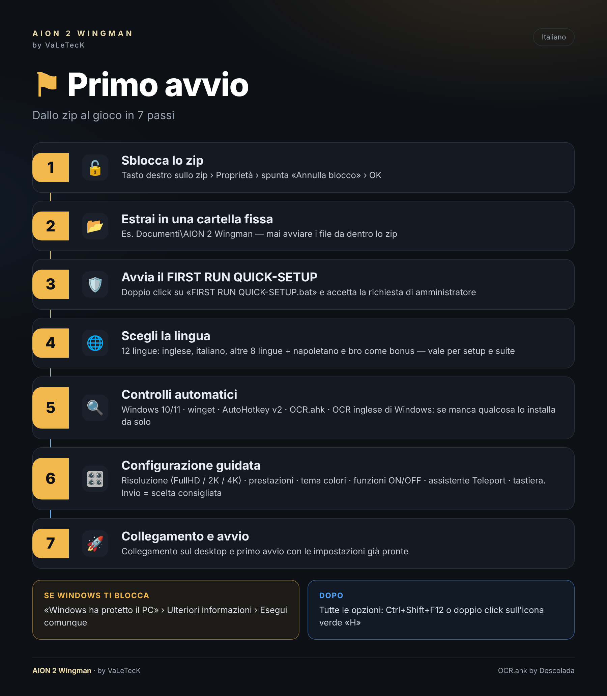 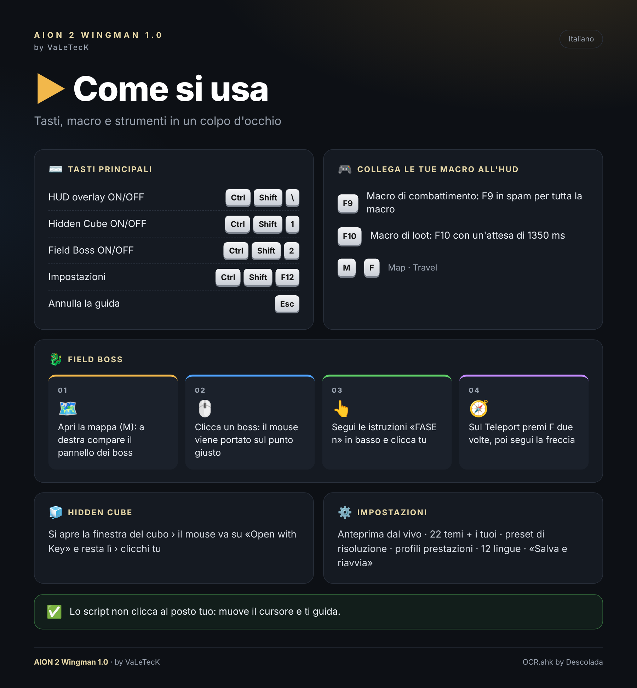

### ⌨️ Tasti predefiniti
| Tasti | Azione |
|---|---|
| `Ctrl+Shift+\` | HUD overlay ON/OFF |
| `Ctrl+Shift+1` | Hidden Cube ON/OFF |
| `Ctrl+Shift+2` | Field Boss ON/OFF |
| `Ctrl+Shift+F12` | Impostazioni (anche fuori dal gioco) |
| `Esc` | Annulla la guida del Field Boss |
| `M` / `F` | Tasti Mappa / Travel del gioco (Wingman li "ascolta") |
| `F9` / `F10` | Segnali delle macro per l'HUD |

Tutti i tasti si cambiano in Impostazioni > Tasti.

### 🎮 Collegare le macro all'HUD
- **Macro di combat**: `F9` in spam per tutta la macro.
- **Macro di loot**: inserisci `F10` con un wait di 1350 ms.

I tasti arrivano comunque al gioco.

### ❓ Domande frequenti
- **In gioco non succede nulla:** Wingman funziona solo con `AION2.exe` in primo piano. Controlla l'icona verde "H" nella barra di Windows.
- **Field Boss "non disponibile":** manca `OCR.ahk` o l'OCR inglese di Windows. Rilancia il FIRST RUN QUICK-SETUP.
- **HUD troppo grande o piccolo:** applica il preset di risoluzione giusto nelle Impostazioni.
- **Avviso dell'antivirus:** è un falso positivo comune con gli script AutoHotkey. Aggiungi la cartella alle esclusioni.

---

## 🇪🇸 Español

**AION 2 Wingman** es un programa para Windows escrito en **AutoHotkey v2**. Funciona junto a AION 2 y te da un HUD más claro y algunas ayudas inteligentes. Es una herramienta de **calidad de vida (QoL)**: menos menús, menos clics y más tiempo para jugar de verdad.

### 🛡️ Seguro por diseño

AION 2 Wingman es un simple script de **AutoHotkey v2**: puedes abrirlo con el Bloc de notas y leer cada línea.

- ❌ **Sin inyección**: nunca toca el proceso del juego, su memoria ni sus archivos.
- ❌ **Sin lectura de paquetes, sin bot**: no lee ni modifica el tráfico de red y nunca juega por ti.
- 👀 **Solo mira la pantalla, como tú**: el OCR integrado de Windows lee las capturas del mapa, en local.
- 🖱️ **Cada clic es tuyo**: mueve el cursor y, en el mapa, usa la rueda del ratón para desplazar la lista y alejar el zoom. El único clic automático (Hidden Cube) está **desactivado por defecto**.
- 🔒 **Sin telemetría**: no envía datos del juego ni personales. Su única conexión es la comprobación de actualizaciones en esta página de GitHub, que puedes desactivar.
- 🗂️ **Todo se queda en tu PC** (`%AppData%\AION 2 Wingman`).
- 🧪 **Analizado en VirusTotal**: cada release enlaza su análisis de VirusTotal en las notas.
- 💚 **100% gratis, para siempre**: sin funciones de pago, sin funciones ocultas, sin anuncios, sin cuenta. Las donaciones son totalmente opcionales y no desbloquean nada.

> ⚠️ Es una herramienta de terceros no oficial: nadie puede garantizar que un programa externo tenga riesgo cero frente a las reglas y el anti-cheat de un juego. Úsala con conciencia y respetando los términos del juego.

### ⚡ La función estrella: el Asistente de Teleport rápido para cada Field Boss

**Del mapa al jefe en 3 movimientos** (ULTRA-FAST MODE, el predeterminado):

1. **Haz clic en el jefe** en el panel Field Boss (abre el mapa con `M`).
2. **Haz clic en el Teleport**: Wingman ya ha encontrado el Teleport del jefe en la lista Kibelisk de la izquierda, se ha desplazado hasta él y ha puesto el cursor encima.
3. **Pulsa `F` dos veces** y sigue la flecha con la **dirección de vuelo** hacia el jefe.

El **NORMAL MODE**, la ruta guiada completa, sigue a un clic en los Ajustes:

Llegar a un Field Boss suele significar abrir el mapa, ir a Exploration y luego a Field Boss, buscar el jefe en una lista larga, encontrar el Teleport más cercano y volar en la dirección correcta. **Wingman lo convierte en unos pocos clics guiados:**

1. **Abre el mapa** (`M`): el panel muestra todos los jefes de la A a la Z con grado, estado e importancia.
2. **Haz clic en un jefe** del panel.
3. Wingman **lleva el cursor paso a paso** a *Exploration*, *Field Boss*, *el jefe* y luego **al Teleport más cercano**, que encuentra solo en el mapa. Una instrucción grande en pantalla y un anillo en el punto exacto te dicen dónde hacer clic.
4. **Pulsa `F`** (Travel): una flecha indica la **dirección de vuelo** hacia el jefe.
5. `Esc` cancela en cualquier momento. En las mazmorras el panel se oculta.

⚡ **Pensado para la velocidad.** Una vez elegido el jefe no hay que apuntar ni leer nada: **haz clic izquierdo sin parar**. En cada paso el cursor ya está en el punto correcto y los clics fuera de tiempo entre pasos se bloquean. En cuanto hagas clic en el Teleport, **pulsa `F` sin parar**: el ratón queda bloqueado unos segundos, así ningún clic erróneo estropea la salida.

🚀 **ULTRA-FAST MODE en detalle.** Wingman desplaza solo la lista Kibelisk hasta encontrar el Teleport. La dirección de vuelo ya está fijada para casi todos los jefes; si no, se calcula desde el icono del jefe más cercano al Teleport, y puedes cambiarla para cada jefe en la lista. El modo se cambia en *Ajustes > Field Boss > Búsqueda y Teleport*; la Home muestra el que está en uso.

### ✨ Funciones
- **🎯 HUD overlay:**
  - mira, dos barras e iconos **LOOT** / **COMBAT** que se encienden con las señales de tus macros (F9 / F10);
  - cada icono tiene su forma, tamaño, posición, textos, emoji y efectos animados, y puede reflejar al otro;
  - textos y emoji se ajustan solos a la forma del icono.
- **👑 Field Boss:**
  - panel con todos los jefes en el mapa, con grado, estado y filtros;
  - **guía paso a paso** hasta el Teleport más cercano y **dirección de vuelo** después del Travel;
  - el panel se oculta en las **mazmorras**.
- **🧊 Hidden Cube:** lleva el ratón a "Open with Key" cuando se abre la ventana.
- **⚙️ Ajustes** (Ctrl+Shift+F12):
  - página **Inicio** con activación de cada función en un clic; modo **Básico** (lo esencial) y **Avanzado** (todas las opciones); se cierra sola al cerrar AION 2 (desactivable);
  - búsqueda, **vista previa en vivo**, presets de resolución (FullHD / 2K / 4K), perfiles de rendimiento y presets propios;
  - menú Mantenimiento y botón **Cerrar Wingman**;
  - **12 idiomas**.
- **🎨 Temas:**
  - **22 temas listos**: clásicos, **8 de clase de AION 2** y **7 de eventos** (Halloween, Navidad, Año Nuevo, San Valentín, Carnaval, Pascua y San Patricio);
  - **Editor de temas**: *Personalizar este tema* crea tu copia "… Custom", editable en cada detalle.
- **🔄 Actualizaciones:** comprueba e instala las nuevas releases sin interrumpirte mientras juegas. Tus ajustes, presets y temas (`%AppData%\AION 2 Wingman`) **se mantienen**.

### 🎛️ Personaliza todo

Cada elemento del HUD y de las herramientas se ajusta a tu gusto, en **aspecto** y en **funcionamiento**: más de 240 opciones con descripción, ejemplo y vista previa en vivo, sin tocar el código.
- **Mira**: forma (distinta para ON y OFF), número, tamaño, grosor, espaciado, animación y velocidad.
- **Barras** e **iconos LOOT / COMBAT**: forma, tamaño, borde, posición, textos, emoji, colores, efectos y fundidos, cada uno por separado.
- **Field Boss y Teleport asistido**: tamaño y posición del panel, filtros, editor de la lista de jefes, comportamiento de la guía, bloqueo del ratón tras el Teleport, flecha de dirección, búsqueda del Teleport, lista de mazmorras.
- **Hidden Cube**, **teclas**, **temas**, **idiomas**, **perfiles de rendimiento** y **presets**.

### 💻 Requisitos
- Windows 10 u 11
- AutoHotkey v2 y el OCR inglés de Windows (los instala el FIRST RUN QUICK-SETUP)
- Cliente de AION 2 en inglés

### 🚀 Instalación y primer inicio: empieza por el FIRST RUN QUICK-SETUP

> **Después de extraer el zip, ejecuta primero `FIRST RUN QUICK-SETUP.bat` con doble clic.** Es el archivo con "QUICK-SETUP" en el nombre, en la carpeta principal del paquete.
>
> El FIRST RUN QUICK-SETUP instala todo lo que Wingman necesita para funcionar al 100% (AutoHotkey v2, el OCR de Windows, la librería OCR) y te guía en una breve configuración inicial: idioma, resolución, rendimiento, tema de colores, funciones ON/OFF y teclado. Al final crea un acceso directo e inicia Wingman ya configurado.

1. Descarga **`AION-2-Wingman.zip`** de la [última release](../../releases/latest).
2. Clic derecho > **Propiedades** > marca **Desbloquear** > Aceptar.
3. Extráelo en una carpeta fija (no lo ejecutes desde dentro del zip).
4. Doble clic en **`FIRST RUN QUICK-SETUP.bat`** y acepta el permiso de administrador.
5. Sigue la configuración guiada (Intro = opción recomendada).
6. Después inicia Wingman con el acceso directo o **`AION 2 Wingman.ahk`**. El FIRST RUN QUICK-SETUP se puede repetir desde *Ajustes > 🛠️ Mantenimiento*.

### 📖 Guía rápida

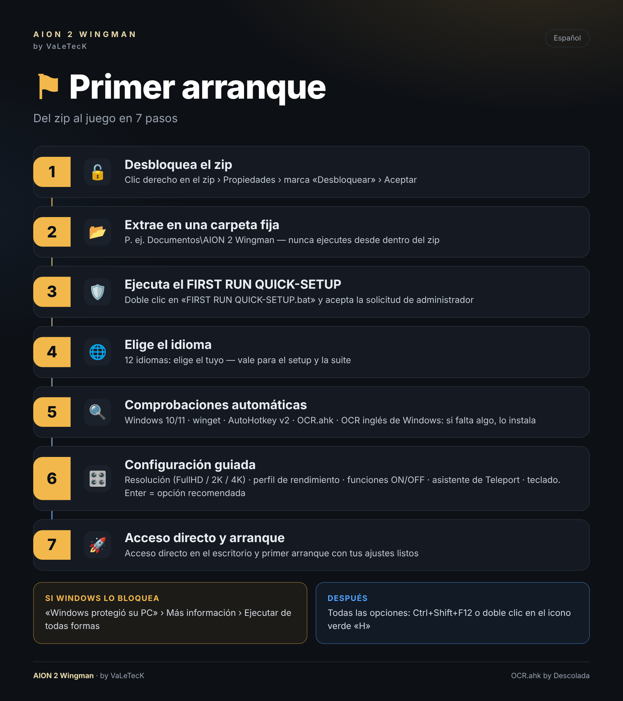 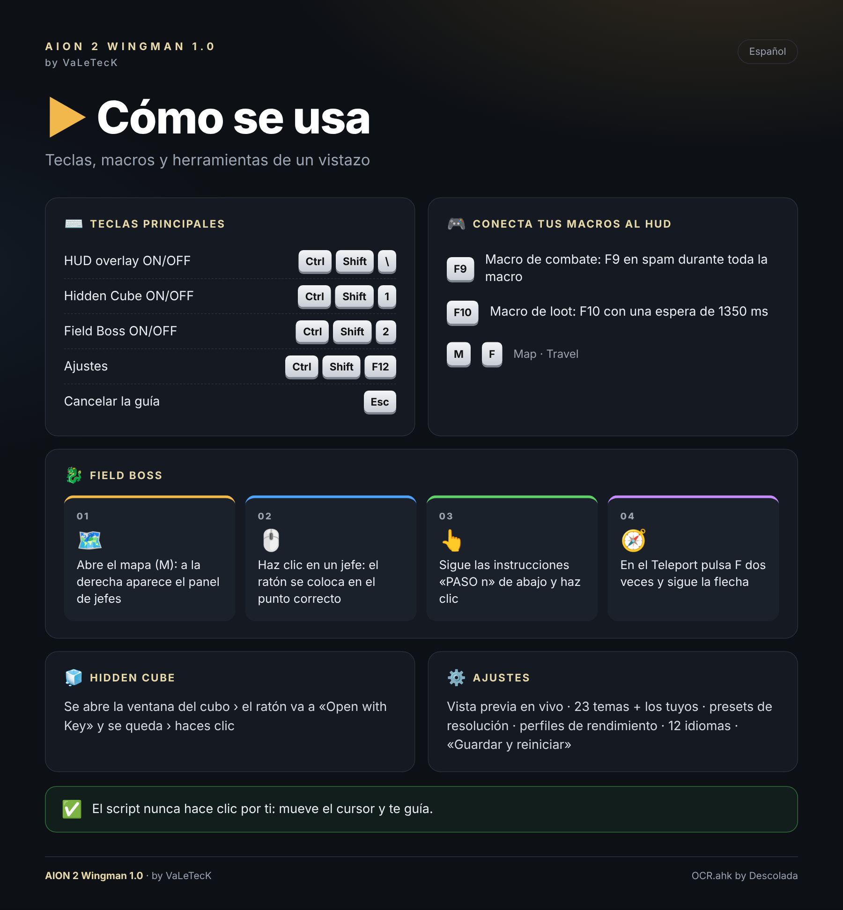

### ⌨️ Teclas predeterminadas
`Ctrl+Shift+\` HUD · `Ctrl+Shift+1` Hidden Cube · `Ctrl+Shift+2` Field Boss · `Ctrl+Shift+F12` Ajustes · `Esc` cancelar guía · `F9` / `F10` señales de las macros (combat: F9 en spam; loot: F10 con espera de 1350 ms).

---

## 🇫🇷 Français

**AION 2 Wingman** est un programme Windows écrit en **AutoHotkey v2**. Il tourne à côté d'AION 2 et t'offre un HUD plus clair et quelques aides intelligentes. C'est un outil de **qualité de vie (QoL)** : moins de menus, moins de clics, plus de temps pour vraiment jouer.

### 🛡️ Sûr par conception

AION 2 Wingman est un simple script **AutoHotkey v2** : tu peux l'ouvrir avec le Bloc-notes et en lire chaque ligne.

- ❌ **Aucune injection** : il ne touche jamais au processus du jeu, à sa mémoire ni à ses fichiers.
- ❌ **Aucune lecture de paquets, aucun bot** : il ne lit ni ne modifie le trafic réseau et ne joue jamais à ta place.
- 👀 **Il regarde seulement l'écran, comme toi** : l'OCR intégré de Windows lit les captures de la carte, en local.
- 🖱️ **Chaque clic est le tien** : il déplace le curseur et, sur la carte, utilise la molette pour faire défiler la liste et dézoomer. Le seul clic automatique (Hidden Cube) est **désactivé par défaut**.
- 🔒 **Aucune télémétrie** : il n'envoie aucune donnée du jeu ni personnelle. Sa seule connexion est la vérification des mises à jour sur cette page GitHub, désactivable.
- 🗂️ **Tout reste sur ton PC** (`%AppData%\AION 2 Wingman`).
- 🧪 **Analysé sur VirusTotal** : chaque release renvoie à son analyse VirusTotal dans les notes.
- 💚 **100 % gratuit, pour toujours** : aucune fonction payante, aucune fonction cachée, pas de pub, pas de compte. Les dons sont entièrement libres et ne débloquent rien.

> ⚠️ C'est un outil tiers non officiel : personne ne peut garantir qu'un programme externe soit sans aucun risque face aux règles et à l'anti-triche d'un jeu. Utilise-le en connaissance de cause et dans le respect des conditions du jeu.

### ⚡ La fonction phare : l'Assistant Teleport rapide pour chaque Field Boss

**De la carte au boss en 3 gestes** (ULTRA-FAST MODE, par défaut) :

1. **Clique le boss** dans le panneau Field Boss (ouvre la carte avec `M`).
2. **Clique le Teleport** : Wingman a déjà trouvé le Teleport du boss dans la liste Kibelisk à gauche, a fait défiler jusqu'à lui et y a placé le curseur.
3. **Appuie deux fois sur `F`** et suis la flèche de **direction de vol** vers le boss.

Le **NORMAL MODE**, le parcours guidé complet, reste à un clic dans les Paramètres :

Rejoindre un Field Boss demande d'habitude d'ouvrir la carte, d'aller dans Exploration puis Field Boss, de chercher le boss dans une longue liste, de trouver le Teleport le plus proche et de voler dans la bonne direction. **Wingman en fait quelques clics guidés :**

1. **Ouvre la carte** (`M`) : le panneau liste tous les boss de A à Z avec grade, état et importance.
2. **Clique sur un boss** dans le panneau.
3. Wingman **guide le curseur étape par étape** vers *Exploration*, *Field Boss*, *le boss* puis **le Teleport le plus proche**, qu'il trouve seul sur la carte. Une grande consigne à l'écran et un anneau sur le point exact te disent où cliquer.
4. **Appuie sur `F`** (Travel) : une flèche indique la **direction de vol** vers le boss.
5. `Esc` annule à tout moment. Dans les donjons, le panneau reste masqué.

⚡ **Pensé pour la vitesse.** Une fois le boss choisi, rien à viser ni à lire : **clique gauche en rafale**. À chaque étape le curseur est déjà au bon endroit et les clics à contretemps entre les étapes sont bloqués. Dès que le Teleport est cliqué, **spamme `F`** : la souris reste bloquée quelques secondes, aucun mauvais clic ne peut gâcher le départ.

🚀 **ULTRA-FAST MODE en détail.** Wingman fait défiler tout seul la liste Kibelisk jusqu'au Teleport. La direction de vol est déjà réglée pour presque tous les boss, sinon elle est calculée depuis l'icône de boss la plus proche du Teleport, et tu peux la changer pour chaque boss dans la liste. Le mode se change dans *Paramètres > Field Boss > Recherche et Teleport* ; la Home indique celui en cours.

### ✨ Fonctions
- **🎯 HUD overlay :**
  - viseur, deux barres et icônes **LOOT** / **COMBAT** qui s'allument avec les signaux de tes macros (F9 / F10) ;
  - chaque icône a sa forme, sa taille, sa position, ses textes, son emoji et ses effets animés, et peut se placer en miroir de l'autre ;
  - textes et emoji s'adaptent seuls à la forme.
- **👑 Field Boss :**
  - panneau de tous les boss de la carte, avec grade, état et filtres ;
  - **guide pas à pas** jusqu'au Teleport le plus proche et **direction de vol** après le Travel ;
  - le panneau est masqué dans les **donjons**.
- **🧊 Hidden Cube :** place la souris sur "Open with Key" quand la fenêtre s'ouvre.
- **⚙️ Paramètres** (Ctrl+Shift+F12) :
  - page **Accueil** pour activer chaque fonction en un clic ; mode **Basique** (l'essentiel) et **Avancé** (toutes les options) ; se ferme seul quand AION 2 se ferme (désactivable) ;
  - recherche, **aperçu en direct**, presets de résolution (FullHD / 2K / 4K), profils de performance et presets perso ;
  - menu Maintenance et bouton **Quitter Wingman** ;
  - **12 langues**.
- **🎨 Thèmes :**
  - **22 thèmes prêts** : classiques, **8 de classe AION 2** et **7 de fêtes** (Halloween, Noël, Nouvel An, Saint-Valentin, Carnaval, Pâques et Saint-Patrick) ;
  - **Éditeur de thèmes** : *Personnaliser ce thème* crée ta copie "… Custom", modifiable dans les moindres détails.
- **🔄 Mises à jour :** vérifie et installe les nouvelles releases sans jamais te déranger en jeu. Tes paramètres, presets et thèmes (`%AppData%\AION 2 Wingman`) **sont conservés**.

### 🎛️ Personnalise tout

Chaque élément du HUD et des outils se règle à ton goût, en **apparence** comme en **fonctionnement** : plus de 240 options avec description, exemple et aperçu en direct, sans toucher au code.
- **Viseur** : forme (différente pour ON et OFF), nombre, taille, épaisseur, espacement, animation et vitesse.
- **Barres** et **icônes LOOT / COMBAT** : forme, taille, cadre, position, textes, emoji, couleurs, effets et fondus, chacun séparément.
- **Field Boss et Teleport assisté** : taille et position du panneau, filtres, éditeur de la liste des boss, comportement du guide, blocage de la souris après le Teleport, flèche de direction, recherche du Teleport, liste des donjons.
- **Hidden Cube**, **touches**, **thèmes**, **langues**, **profils de performance** et **presets**.

### 💻 Configuration requise
- Windows 10 ou 11
- AutoHotkey v2 et l'OCR anglais de Windows (installés par le FIRST RUN QUICK-SETUP)
- Client AION 2 en anglais

### 🚀 Installation et premier lancement : commence par le FIRST RUN QUICK-SETUP

> **Après avoir extrait le zip, lance d'abord `FIRST RUN QUICK-SETUP.bat` par un double-clic.** C'est le fichier avec "QUICK-SETUP" dans le nom, dans le dossier principal du paquet.
>
> Le FIRST RUN QUICK-SETUP installe tout ce dont Wingman a besoin pour fonctionner à 100 % (AutoHotkey v2, l'OCR de Windows, la bibliothèque OCR) et te guide dans une courte configuration : langue, résolution, performance, thème, fonctions ON/OFF et clavier. À la fin, il crée un raccourci et lance Wingman déjà configuré.

1. Télécharge **`AION-2-Wingman.zip`** depuis la [dernière release](../../releases/latest).
2. Clic droit > **Propriétés** > coche **Débloquer** > OK.
3. Extrais-le dans un dossier fixe (ne le lance pas depuis le zip).
4. Double-clic sur **`FIRST RUN QUICK-SETUP.bat`** et accepte la demande d'administrateur.
5. Suis la configuration guidée (Entrée = choix recommandé).
6. Ensuite, lance Wingman avec le raccourci ou **`AION 2 Wingman.ahk`**. Le FIRST RUN QUICK-SETUP peut être relancé depuis *Paramètres > 🛠️ Maintenance*.

### 📖 Guide rapide

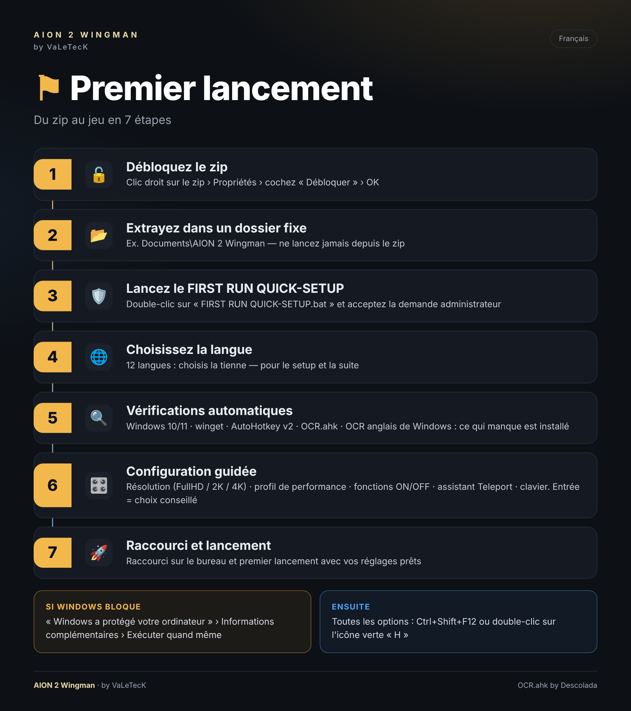 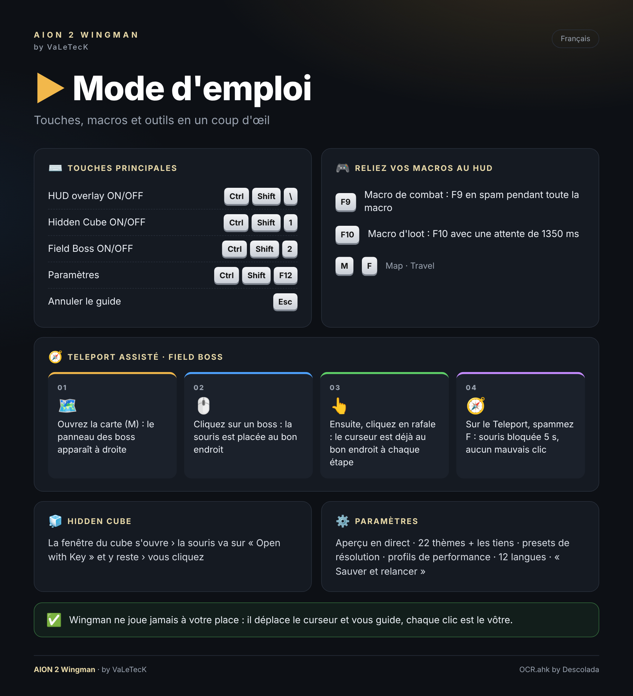

### ⌨️ Touches par défaut
`Ctrl+Shift+\` HUD · `Ctrl+Shift+1` Hidden Cube · `Ctrl+Shift+2` Field Boss · `Ctrl+Shift+F12` Paramètres · `Esc` annuler le guide · `F9` / `F10` signaux des macros (combat : F9 en spam ; loot : F10 avec une attente de 1350 ms).

---

## 🇩🇪 Deutsch

**AION 2 Wingman** ist ein Windows-Programm in **AutoHotkey v2**. Es läuft neben AION 2 und bietet ein klareres HUD sowie einige smarte Helfer. Es ist ein **Quality-of-Life-Tool (QoL)**: weniger Menüs, weniger Klicks, mehr Zeit zum Spielen.

### 🛡️ Sicher durch Bauweise

AION 2 Wingman ist ein einfaches **AutoHotkey-v2**-Skript: Du kannst es mit dem Editor öffnen und jede Zeile lesen.

- ❌ **Keine Injection**: Es greift nie auf den Spielprozess, seinen Speicher oder seine Dateien zu.
- ❌ **Kein Paketmitlesen, kein Bot**: Es liest oder verändert keinen Netzwerkverkehr und spielt nie für dich.
- 👀 **Es schaut nur auf den Bildschirm, wie du**: Die Windows-OCR liest Kartenbilder lokal auf deinem PC.
- 🖱️ **Jeder Klick ist deiner**: Es bewegt den Cursor und scrollt auf der Karte mit dem Mausrad durch die Liste und zoomt heraus. Der einzige automatische Klick (Hidden Cube) ist **standardmäßig aus**.
- 🔒 **Keine Telemetrie**: Es sendet keine Spiel- oder persönlichen Daten. Die einzige Verbindung ist die abschaltbare Update-Prüfung auf dieser GitHub-Seite.
- 🗂️ **Alles bleibt auf deinem PC** (`%AppData%\AION 2 Wingman`).
- 🧪 **Auf VirusTotal geprüft**: Jede Release verlinkt ihren VirusTotal-Scan in den Release-Notes.
- 💚 **Zu 100 % kostenlos, für immer**: keine kostenpflichtigen Funktionen, keine versteckten Funktionen, keine Werbung, kein Konto. Spenden sind völlig freiwillig und schalten nichts frei.

> ⚠️ Es ist ein inoffizielles Drittanbieter-Tool: Niemand kann garantieren, dass ein externes Programm gegenüber den Regeln und dem Anti-Cheat eines Spiels völlig risikofrei ist. Nutze es bewusst und im Rahmen der Nutzungsbedingungen.

### ⚡ Die Hauptfunktion: der schnelle Teleport-Assistent für jeden Field Boss

**Von der Karte zum Boss in 3 Schritten** (ULTRA-FAST MODE, Standard):

1. **Klicke den Boss** im Field-Boss-Panel an (Karte mit `M` öffnen).
2. **Klicke den Teleport** an: Wingman hat den Teleport des Bosses schon in der Kibelisk-Liste links gefunden, dorthin gescrollt und den Cursor daraufgesetzt.
3. **Drücke zweimal `F`** und folge dem Pfeil mit der **Flugrichtung** zum Boss.

Der **NORMAL MODE**, die vollständige geführte Route, ist in den Einstellungen nur einen Klick entfernt:

Normalerweise musst du für einen Field Boss die Karte öffnen, zu Exploration und dann Field Boss gehen, den Boss in einer langen Liste suchen, den nächsten Teleport finden und in die richtige Richtung fliegen. **Wingman macht daraus ein paar geführte Klicks:**

1. **Karte öffnen** (`M`): Das Panel listet alle Bosse von A bis Z mit Grad, Status und Wichtigkeit.
2. **Einen Boss anklicken** im Panel.
3. Wingman **führt den Cursor Schritt für Schritt** zu *Exploration*, *Field Boss*, *dem Boss* und dann **zum nächsten Teleport**, den es selbst auf der Karte findet. Eine große Anweisung und ein Ring auf der genauen Stelle zeigen dir, wo du klicken musst.
4. **`F` drücken** (Travel): Ein Pfeil zeigt die **Flugrichtung** zum Boss.
5. `Esc` bricht jederzeit ab. In Dungeons bleibt das Panel ausgeblendet.

⚡ **Auf Tempo gebaut.** Ist der Boss gewählt, musst du nichts mehr zielen oder lesen: **einfach weiter Linksklick spammen**. Bei jedem Schritt steht der Cursor schon richtig, und Klicks zur falschen Zeit zwischen den Schritten werden blockiert. Sobald der Teleport angeklickt ist, **F spammen**: Die Maus bleibt ein paar Sekunden gesperrt, damit kein Fehlklick den Abflug stört.

🚀 **ULTRA-FAST MODE im Detail.** Wingman scrollt die Kibelisk-Liste selbst, bis der Teleport gefunden ist. Die Flugrichtung ist für fast alle Bosse schon eingestellt, sonst wird sie aus dem Boss-Symbol berechnet, das dem Teleport am nächsten ist; pro Boss änderbar in der Boss-Liste. Modus wechseln unter *Einstellungen > Field Boss > Suche und Teleport*; die Home-Seite zeigt den aktiven Modus.

### ✨ Funktionen
- **🎯 HUD-Overlay:**
  - Fadenkreuz, zwei Balken und **LOOT**- / **COMBAT**-Symbole, die durch die Signale deiner Makros (F9 / F10) aufleuchten;
  - jedes Symbol hat eigene Form, Größe, Position, Texte, Emoji und animierte Effekte und kann das andere spiegeln;
  - Text und Emoji passen sich der Form selbst an.
- **👑 Field Boss:**
  - Panel mit allen Bossen auf der Karte, mit Grad, Status und Filtern;
  - **Schritt-für-Schritt-Führung** zum nächsten Teleport und **Flugrichtung** nach dem Travel;
  - in **Dungeons** bleibt das Panel ausgeblendet.
- **🧊 Hidden Cube:** bringt die Maus auf "Open with Key", sobald sich das Fenster öffnet.
- **⚙️ Einstellungen** (Ctrl+Shift+F12):
  - **Startseite** zum Ein-/Ausschalten jeder Funktion mit einem Klick; **Basis**-Modus (das Wichtigste) und **Erweitert** (alle Optionen); beendet sich mit AION 2 (abschaltbar);
  - Suche, **Live-Vorschau**, Auflösungs-Presets (FullHD / 2K / 4K), Leistungsprofile und eigene Presets;
  - Wartungsmenü und Knopf **Wingman beenden**;
  - **12 Sprachen**.
- **🎨 Designs:**
  - **22 fertige Designs**: Klassiker, **8 AION-2-Klassen** und **7 Feiertage** (Halloween, Weihnachten, Neujahr, Valentinstag, Karneval, Ostern und St. Patrick's Day);
  - **Design-Editor**: *Dieses Design anpassen* erstellt deine eigene Kopie "… Custom", die du in jedem Detail ändern kannst.
- **🔄 Updates:** prüft und installiert neue Releases, ohne dich beim Spielen zu stören. Einstellungen, Presets und Designs (`%AppData%\AION 2 Wingman`) **bleiben erhalten**.

### 🎛️ Alles anpassen

Jedes Element von HUD und Tools lässt sich nach deinem Geschmack einstellen, in **Aussehen** und **Verhalten**: über 240 Optionen mit Beschreibung, Beispiel und Live-Vorschau, ohne den Code anzufassen.
- **Fadenkreuz**: Form (getrennt für AN und AUS), Anzahl, Größe, Stärke, Abstand, Animation und Tempo.
- **Balken** und **LOOT-/COMBAT-Symbole**: Form, Größe, Rahmen, Position, Texte, Emoji, Farben, Effekte und Überblendungen, jeweils einzeln.
- **Field Boss und assistierter Teleport**: Größe und Position des Panels, Filter, Editor der Bossliste, Verhalten der Führung, Maussperre nach dem Teleport, Richtungspfeil, Teleport-Suche, Dungeon-Liste.
- **Hidden Cube**, **Tasten**, **Designs**, **Sprachen**, **Leistungsprofile** und **Presets**.

### 💻 Voraussetzungen
- Windows 10 oder 11
- AutoHotkey v2 und die englische Windows-OCR (installiert das FIRST RUN QUICK-SETUP)
- Englischer AION-2-Client

### 🚀 Installation und erster Start: mit dem FIRST RUN QUICK-SETUP beginnen

> **Nach dem Entpacken zuerst `FIRST RUN QUICK-SETUP.bat` doppelklicken.** Das ist die Datei mit "QUICK-SETUP" im Namen, im Hauptordner des Pakets.
>
> Das FIRST RUN QUICK-SETUP installiert alles, was Wingman für den vollen Betrieb braucht (AutoHotkey v2, die Windows-OCR, die OCR-Bibliothek), und führt dich durch eine kurze Ersteinrichtung: Sprache, Auflösung, Leistung, Farbdesign, Funktionen AN/AUS und Tastatur. Am Ende erstellt es eine Verknüpfung und startet Wingman fertig eingestellt.

1. **`AION-2-Wingman.zip`** aus der [neuesten Release](../../releases/latest) herunterladen.
2. Rechtsklick > **Eigenschaften** > **Zulassen** anhaken > OK.
3. In einen festen Ordner entpacken (nicht aus dem Zip starten).
4. **`FIRST RUN QUICK-SETUP.bat`** doppelklicken und die Administratorabfrage bestätigen.
5. Der geführten Einrichtung folgen (Enter = empfohlene Wahl).
6. Danach Wingman über die Verknüpfung oder **`AION 2 Wingman.ahk`** starten. Das FIRST RUN QUICK-SETUP lässt sich unter *Einstellungen > 🛠️ Wartung* erneut starten.

### 📖 Kurzanleitung

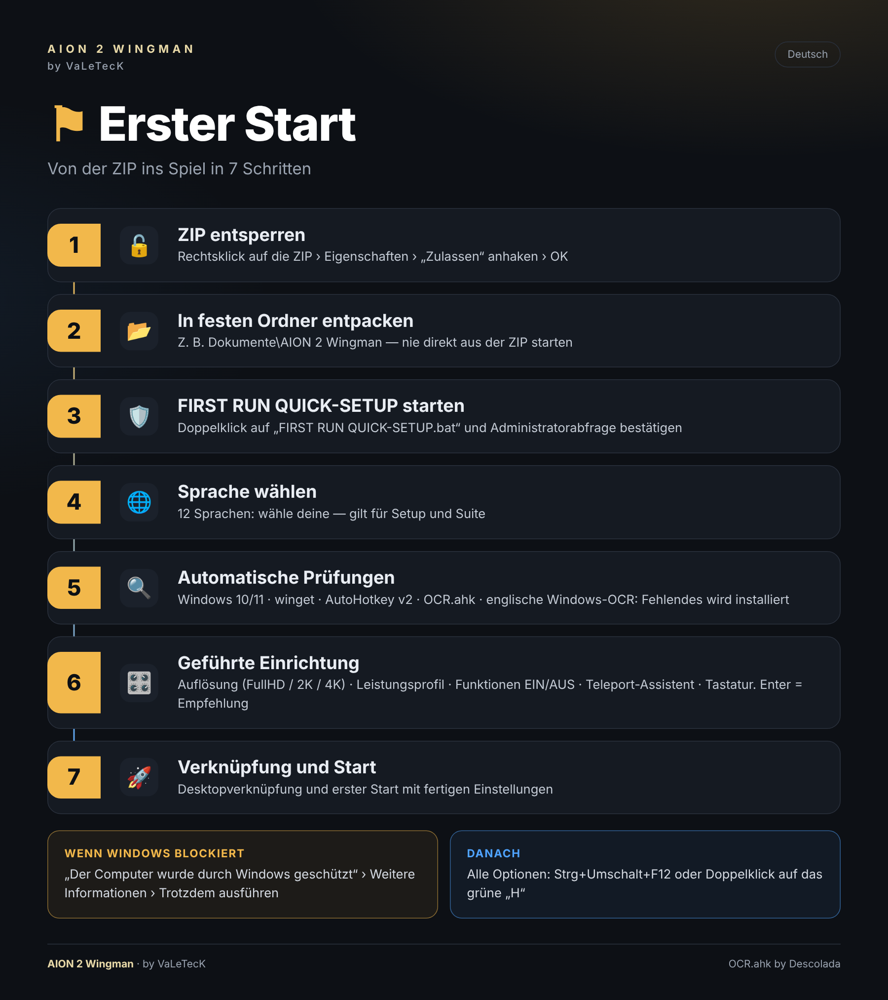 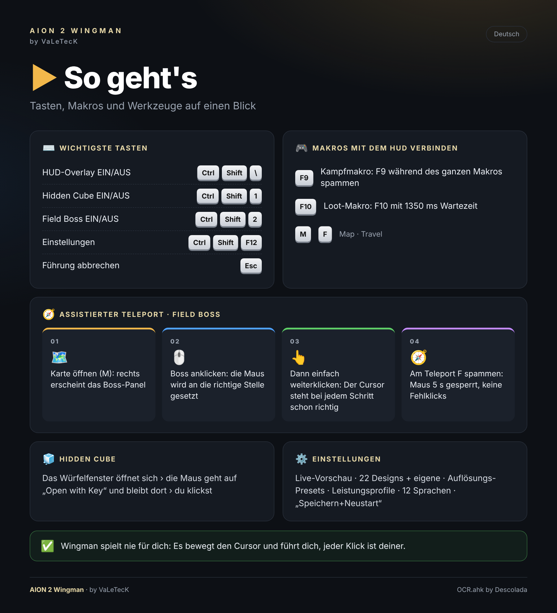

### ⌨️ Standardtasten
`Ctrl+Shift+\` HUD · `Ctrl+Shift+1` Hidden Cube · `Ctrl+Shift+2` Field Boss · `Ctrl+Shift+F12` Einstellungen · `Esc` Führung abbrechen · `F9` / `F10` Makro-Signale (Kampf: F9 dauerhaft drücken; Loot: F10 mit 1350 ms Wartezeit).

---

## 🇧🇷 Português

**AION 2 Wingman** é um programa para Windows escrito em **AutoHotkey v2**. Ele roda junto com o AION 2 e oferece um HUD mais claro e algumas ajudas inteligentes. É uma ferramenta de **qualidade de vida (QoL)**: menos menus, menos cliques e mais tempo para jogar de verdade.

### 🛡️ Seguro por natureza

O AION 2 Wingman é um simples script **AutoHotkey v2**: você pode abri-lo no Bloco de Notas e ler cada linha.

- ❌ **Sem injeção**: nunca mexe no processo do jogo, na memória ou nos arquivos dele.
- ❌ **Sem leitura de pacotes, sem bot**: não lê nem altera o tráfego de rede e nunca joga por você.
- 👀 **Só olha a tela, como você**: o OCR do Windows lê as capturas do mapa, localmente.
- 🖱️ **Cada clique é seu**: move o cursor e, no mapa, usa a roda do mouse para rolar a lista e afastar o zoom. O único clique automático (Hidden Cube) vem **desligado**.
- 🔒 **Sem telemetria**: não envia dados do jogo nem pessoais. A única conexão é a verificação de atualizações nesta página do GitHub, que pode ser desligada.
- 🗂️ **Tudo fica no seu PC** (`%AppData%\AION 2 Wingman`).
- 🧪 **Verificado no VirusTotal**: cada release traz o link da análise do VirusTotal nas notas.
- 💚 **100% gratuito, para sempre**: sem funções pagas, sem funções ocultas, sem anúncios, sem conta. As doações são totalmente opcionais e não liberam nada.

> ⚠️ É uma ferramenta de terceiros não oficial: ninguém pode garantir que um programa externo tenha risco zero diante das regras e do anti-cheat de um jogo. Use com consciência e respeitando os termos do jogo.

### ⚡ A função principal: o Assistente de Teleport rápido para cada Field Boss

**Do mapa ao chefe em 3 movimentos** (ULTRA-FAST MODE, o padrão):

1. **Clique no chefe** no painel Field Boss (abra o mapa com `M`).
2. **Clique no Teleport**: o Wingman já encontrou o Teleport do chefe na lista Kibelisk à esquerda, rolou até ele e colocou o cursor em cima.
3. **Aperte `F` duas vezes** e siga a seta com a **direção de voo** até o chefe.

O **NORMAL MODE**, a rota guiada completa, continua a um clique nas Configurações:

Normalmente, chegar a um Field Boss significa abrir o mapa, ir em Exploration e depois Field Boss, procurar o chefe numa lista longa, achar o Teleport mais próximo e voar na direção certa. **O Wingman transforma isso em poucos cliques guiados:**

1. **Abra o mapa** (`M`): o painel lista todos os chefes de A a Z com grau, estado e importância.
2. **Clique num chefe** no painel.
3. O Wingman **leva o cursor passo a passo** até *Exploration*, *Field Boss*, *o chefe* e depois **o Teleport mais próximo**, que ele encontra sozinho no mapa. Uma instrução grande na tela e um anel no ponto exato mostram onde clicar.
4. **Aperte `F`** (Travel): uma seta mostra a **direção de voo** até o chefe.
5. `Esc` cancela a qualquer momento. Nas masmorras o painel fica oculto.

⚡ **Feito para ser rápido.** Escolhido o chefe, não precisa mirar nem ler nada: **clique com o botão esquerdo sem parar**. Em cada passo o cursor já está no ponto certo e os cliques fora de hora entre os passos são bloqueados. Assim que clicar no Teleport, **aperte `F` sem parar**: o mouse fica travado por alguns segundos, então nenhum clique errado atrapalha a partida.

🚀 **ULTRA-FAST MODE em detalhe.** O Wingman rola sozinho a lista Kibelisk até achar o Teleport. A direção de voo já vem definida para quase todos os chefes; senão, é calculada pelo ícone de chefe mais próximo do Teleport, e você pode mudá-la para cada chefe na lista. Troque o modo em *Configurações > Field Boss > Busca e Teleport*; a Home mostra o modo em uso.

### ✨ Funções
- **🎯 HUD overlay:**
  - mira, duas barras e ícones **LOOT** / **COMBAT** que acendem com os sinais das suas macros (F9 / F10);
  - cada ícone tem forma, tamanho, posição, textos, emoji e efeitos animados próprios, e pode espelhar o outro;
  - textos e emoji se ajustam sozinhos à forma.
- **👑 Field Boss:**
  - painel com todos os chefes do mapa, com grau, estado e filtros;
  - **guia passo a passo** até o Teleport mais próximo e **direção de voo** após o Travel;
  - o painel fica oculto nas **masmorras**.
- **🧊 Hidden Cube:** leva o mouse até "Open with Key" quando a janela abre.
- **⚙️ Configurações** (Ctrl+Shift+F12):
  - página **Início** para ligar cada função com um clique; modo **Básico** (o essencial) e **Avançado** (todas as opções); fecha sozinho ao fechar o AION 2 (desativável);
  - busca, **prévia ao vivo**, presets de resolução (FullHD / 2K / 4K), perfis de desempenho e presets próprios;
  - menu Manutenção e botão **Encerrar Wingman**;
  - **12 idiomas**.
- **🎨 Temas:**
  - **22 temas prontos**: clássicos, **8 de classe do AION 2** e **7 de datas comemorativas** (Halloween, Natal, Ano Novo, Dia dos Namorados, Carnaval, Páscoa e Dia de São Patrício);
  - **Editor de temas**: *Personalizar este tema* cria a sua cópia "… Custom", editável em cada detalhe.
- **🔄 Atualizações:** verifica e instala as novas releases sem atrapalhar enquanto você joga. Configurações, presets e temas (`%AppData%\AION 2 Wingman`) **são mantidos**.

### 🎛️ Personalize tudo

Cada elemento do HUD e das ferramentas se ajusta ao seu gosto, na **aparência** e no **funcionamento**: mais de 240 opções com descrição, exemplo e prévia ao vivo, sem mexer no código.
- **Mira**: forma (diferente para ON e OFF), quantidade, tamanho, espessura, espaçamento, animação e velocidade.
- **Barras** e **ícones LOOT / COMBAT**: forma, tamanho, borda, posição, textos, emoji, cores, efeitos e transições, cada um separado.
- **Field Boss e Teleport assistido**: tamanho e posição do painel, filtros, editor da lista de chefes, comportamento do guia, bloqueio do mouse após o Teleport, seta de direção, busca do Teleport, lista de masmorras.
- **Hidden Cube**, **teclas**, **temas**, **idiomas**, **perfis de desempenho** e **presets**.

### 💻 Requisitos
- Windows 10 ou 11
- AutoHotkey v2 e o OCR em inglês do Windows (instalados pelo FIRST RUN QUICK-SETUP)
- Cliente do AION 2 em inglês

### 🚀 Instalação e primeiro uso: comece pelo FIRST RUN QUICK-SETUP

> **Depois de extrair o zip, execute primeiro `FIRST RUN QUICK-SETUP.bat` com dois cliques.** É o arquivo com "QUICK-SETUP" no nome, na pasta principal do pacote.
>
> O FIRST RUN QUICK-SETUP instala tudo o que o Wingman precisa para funcionar 100% (AutoHotkey v2, o OCR do Windows, a biblioteca OCR) e guia uma configuração inicial rápida: idioma, resolução, desempenho, tema, funções ON/OFF e teclado. No final cria um atalho e abre o Wingman já configurado.

1. Baixe **`AION-2-Wingman.zip`** da [última release](../../releases/latest).
2. Botão direito > **Propriedades** > marque **Desbloquear** > OK.
3. Extraia em uma pasta fixa (não execute de dentro do zip).
4. Dois cliques em **`FIRST RUN QUICK-SETUP.bat`** e aceite a permissão de administrador.
5. Siga a configuração guiada (Enter = opção recomendada).
6. Depois abra o Wingman pelo atalho ou por **`AION 2 Wingman.ahk`**. O FIRST RUN QUICK-SETUP pode ser repetido em *Configurações > 🛠️ Manutenção*.

### 📖 Guia rápido

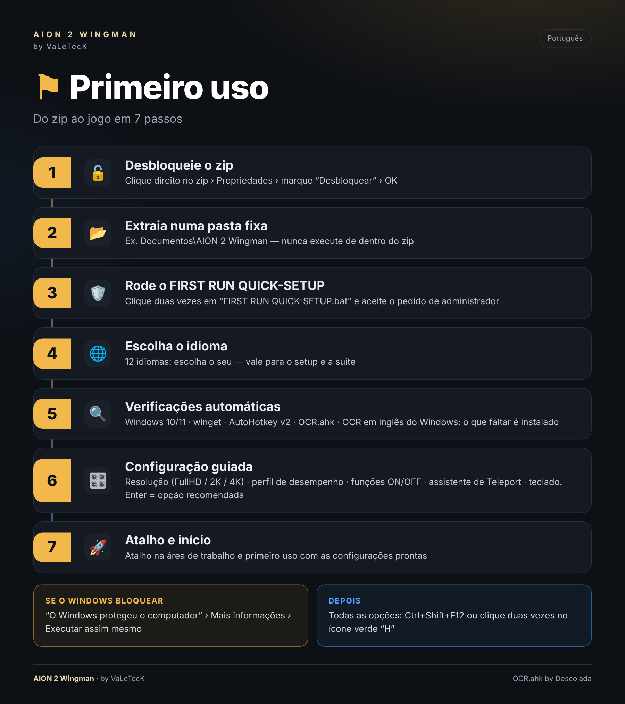 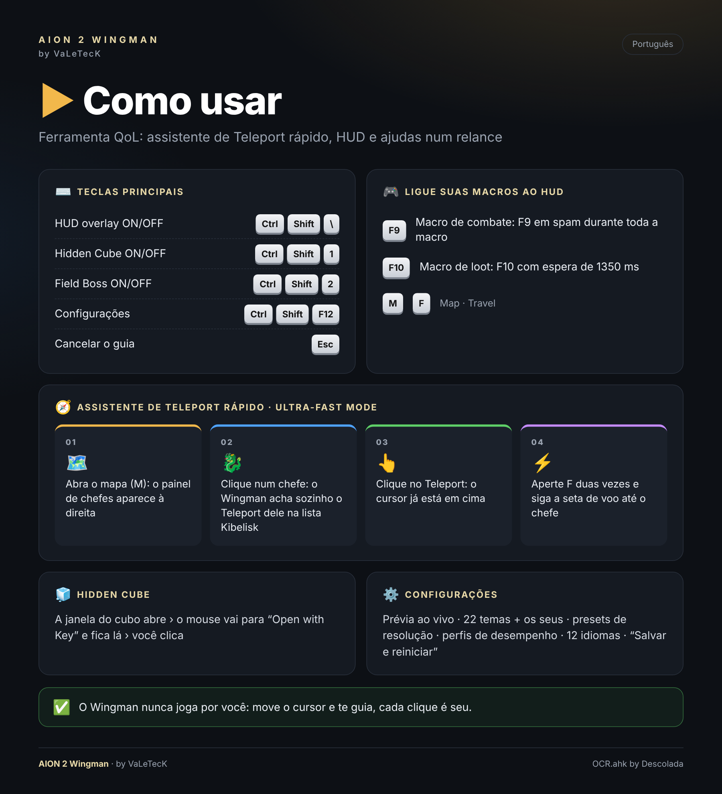

### ⌨️ Teclas padrão
`Ctrl+Shift+\` HUD · `Ctrl+Shift+1` Hidden Cube · `Ctrl+Shift+2` Field Boss · `Ctrl+Shift+F12` Configurações · `Esc` cancelar guia · `F9` / `F10` sinais das macros (combate: F9 em spam; loot: F10 com espera de 1350 ms).

---

## 🇷🇺 Русский

**AION 2 Wingman** — программа для Windows на **AutoHotkey v2**. Она работает рядом с AION 2 и добавляет понятный HUD и несколько умных помощников. Это инструмент для **удобства игры (QoL)**: меньше меню, меньше кликов, больше времени на саму игру.

### 🛡️ Безопасен по устройству

AION 2 Wingman — обычный скрипт **AutoHotkey v2**: его можно открыть Блокнотом и прочитать каждую строку.

- ❌ **Никаких инъекций**: не трогает процесс игры, её память и файлы.
- ❌ **Не читает пакеты, не бот**: не читает и не меняет сетевой трафик и никогда не играет за вас.
- 👀 **Только смотрит на экран, как вы**: снимки карты читает встроенный OCR Windows, локально.
- 🖱️ **Каждый клик — ваш**: двигает курсор, а на карте прокручивает колесом мыши список и отдаляет масштаб. Единственный автоклик (Hidden Cube) **по умолчанию выключен**.
- 🔒 **Никакой телеметрии**: не отправляет игровые или личные данные. Единственное подключение — проверка обновлений на этой странице GitHub, её можно отключить.
- 🗂️ **Всё остаётся на вашем ПК** (`%AppData%\AION 2 Wingman`).
- 🧪 **Проверено на VirusTotal**: у каждого релиза в примечаниях есть ссылка на проверку VirusTotal.
- 💚 **Полностью бесплатно, навсегда**: никаких платных и скрытых функций, рекламы и аккаунтов. Пожертвования — только по желанию и ничего не открывают.

> ⚠️ Это неофициальный сторонний инструмент: никто не может гарантировать, что внешняя программа абсолютно безопасна с точки зрения правил и античита игры. Пользуйтесь осознанно и в рамках условий игры.

### ⚡ Главная функция: быстрый помощник телепорта к любому Field Boss

**С карты к боссу за 3 действия** (ULTRA-FAST MODE, по умолчанию):

1. **Кликните босса** на панели Field Boss (карта открывается клавишей `M`).
2. **Кликните Teleport**: Wingman уже нашёл телепорт босса в списке Kibelisk слева, прокрутил к нему и поставил на него курсор.
3. **Дважды нажмите `F`** и следуйте стрелке с **направлением полёта** к боссу.

**NORMAL MODE** — полный пошаговый маршрут — остаётся в одном клике в настройках:

Обычно, чтобы добраться до Field Boss, нужно открыть карту, перейти в Exploration, затем в Field Boss, найти босса в длинном списке, найти ближайший Teleport и лететь в нужную сторону. **Wingman превращает это в несколько кликов с подсказками:**

1. **Откройте карту** (`M`): панель показывает всех боссов от A до Z с грейдом, статусом и важностью.
2. **Кликните по боссу** на панели.
3. Wingman **шаг за шагом подводит курсор** к *Exploration*, *Field Boss*, *боссу* и затем **к ближайшему Teleport**, который сам находит на карте. Крупная подсказка на экране и кольцо на нужной точке показывают, куда кликнуть.
4. **Нажмите `F`** (Travel): стрелка покажет **направление полёта** к боссу.
5. `Esc` отменяет в любой момент. В подземельях панель скрыта.

⚡ **Сделано для скорости.** После выбора босса не нужно ни целиться, ни читать: **просто жмите левый клик без остановки**. На каждом шаге курсор уже стоит в нужной точке, а лишние клики между шагами блокируются. Как только кликнули по Teleport, **жмите `F` без остановки**: мышь на несколько секунд заблокирована, и никакой случайный клик не помешает отправлению.

🚀 **ULTRA-FAST MODE подробнее.** Wingman сам прокручивает список Kibelisk, пока не найдёт Teleport. Направление полёта уже задано почти для всех боссов, иначе оно рассчитывается по значку босса, ближайшему к Teleport; для каждого босса его можно изменить в списке боссов. Режим меняется в *Настройки > Field Boss > Поиск и Teleport*; на странице Home виден текущий режим.

### ✨ Возможности
- **🎯 HUD-оверлей:**
  - прицел, две полосы и значки **LOOT** / **COMBAT**, которые загораются по сигналам ваших макросов (F9 / F10);
  - у каждого значка своя форма, размер, позиция, текст, эмодзи и анимированные эффекты; значки могут располагаться зеркально друг к другу;
  - текст и эмодзи сами подстраиваются под форму значка.
- **👑 Field Boss:**
  - панель со всеми боссами на карте: грейд, статус и фильтры;
  - **пошаговая подсказка** до ближайшего Teleport и **направление полёта** после Travel;
  - в **подземельях** панель скрыта.
- **🧊 Hidden Cube:** когда открывается окно, переносит мышь на «Open with Key».
- **⚙️ Настройки** (Ctrl+Shift+F12):
  - **Главная** страница: каждая функция включается одним кликом; **Базовый** режим (самое нужное) и **Расширенный** (все параметры); закрывается вместе с AION 2 (можно отключить);
  - поиск, **живой предпросмотр**, пресеты разрешения (FullHD / 2K / 4K), профили производительности и свои пресеты;
  - меню «Обслуживание» и кнопка **Выйти из Wingman**;
  - **12 языков**.
- **🎨 Темы:**
  - **22 готовые темы**: классические, **8 классов AION 2** и **7 праздничных** (Хэллоуин, Рождество, Новый год, День святого Валентина, Карнавал, Пасха и День святого Патрика);
  - **Редактор тем**: кнопка «Настроить эту тему» создаёт вашу копию «… Custom», которую можно менять до мелочей.
- **🔄 Обновления:** проверяет и устанавливает новые релизы, не мешая игре. Настройки, пресеты и темы (`%AppData%\AION 2 Wingman`) **сохраняются**.

### 🎛️ Настраивается всё

Каждый элемент HUD и инструментов настраивается под вас — и **внешний вид**, и **поведение**: более 240 параметров с описанием, примером и живым предпросмотром, без правки кода.
- **Прицел**: форма (отдельно для ВКЛ и ВЫКЛ), количество, размер, толщина, интервалы, анимация и скорость.
- **Полосы** и **значки LOOT / COMBAT**: форма, размер, рамка, позиция, тексты, эмодзи, цвета, эффекты и переходы — каждый отдельно.
- **Field Boss и телепорт с подсказками**: размер и позиция панели, фильтры, редактор списка боссов, поведение подсказок, блокировка мыши после Teleport, стрелка направления, поиск Teleport, список подземелий.
- **Hidden Cube**, **клавиши**, **темы**, **языки**, **профили производительности** и **пресеты**.

### 💻 Требования
- Windows 10 или 11
- AutoHotkey v2 и английский OCR Windows (их ставит FIRST RUN QUICK-SETUP)
- Клиент AION 2 на английском

### 🚀 Установка и первый запуск: начните с FIRST RUN QUICK-SETUP

> **После распаковки zip сначала дважды щёлкните `FIRST RUN QUICK-SETUP.bat`.** Это файл со словом "QUICK-SETUP" в названии, в главной папке пакета.
>
> FIRST RUN QUICK-SETUP установит всё, что нужно Wingman для полноценной работы (AutoHotkey v2, OCR Windows, библиотеку OCR), и проведёт через короткую первичную настройку: язык, разрешение, производительность, тема, функции ВКЛ/ВЫКЛ и клавиатура. В конце он создаст ярлык и запустит уже настроенный Wingman.

1. Скачайте **`AION-2-Wingman.zip`** из [последнего релиза](../../releases/latest).
2. Правый клик > **Свойства** > отметьте **Разблокировать** > OK.
3. Распакуйте в постоянную папку (не запускайте из zip).
4. Дважды щёлкните **`FIRST RUN QUICK-SETUP.bat`** и подтвердите запрос администратора.
5. Следуйте мастеру (Enter = рекомендуемый вариант).
6. Затем запускайте Wingman ярлыком или **`AION 2 Wingman.ahk`**. FIRST RUN QUICK-SETUP можно перезапустить в *Настройки > 🛠️ Обслуживание*.

### 📖 Краткое руководство

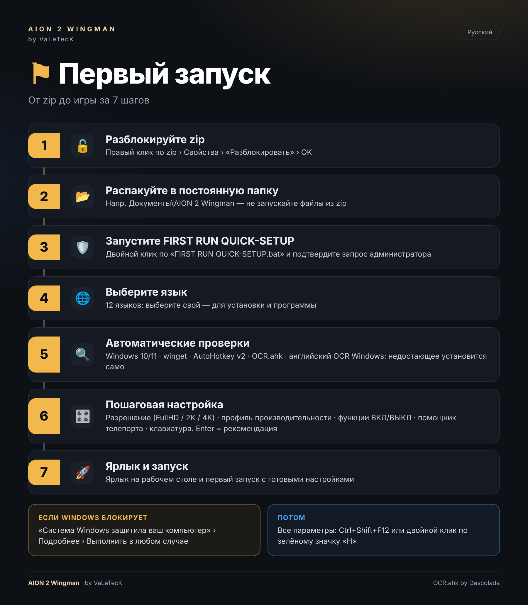 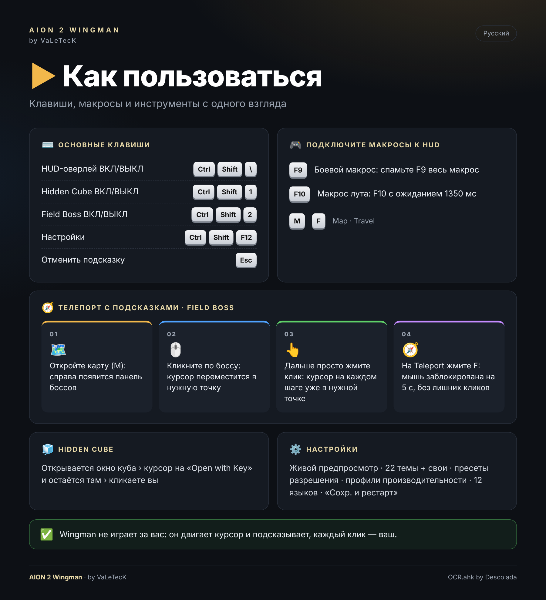

### ⌨️ Клавиши по умолчанию
`Ctrl+Shift+\` HUD · `Ctrl+Shift+1` Hidden Cube · `Ctrl+Shift+2` Field Boss · `Ctrl+Shift+F12` Настройки · `Esc` отменить подсказку · `F9` / `F10` сигналы макросов (бой: спам F9; лут: F10 с ожиданием 1350 мс).

---

## 🇰🇷 한국어

**AION 2 Wingman**은 **AutoHotkey v2**로 만든 Windows 프로그램입니다. AION 2와 함께 실행되며 더 보기 쉬운 HUD와 몇 가지 똑똑한 보조 기능을 제공합니다. **편의성(QoL)** 도구입니다: 메뉴와 클릭은 줄이고, 게임하는 시간은 늘립니다.

### 🛡️ 구조적으로 안전

AION 2 Wingman은 평범한 **AutoHotkey v2** 스크립트입니다. 메모장으로 열어 모든 줄을 확인할 수 있습니다.

- ❌ **인젝션 없음**: 게임 프로세스, 메모리, 파일을 절대 건드리지 않습니다.
- ❌ **패킷 읽기 없음, 봇 아님**: 네트워크 트래픽을 읽거나 바꾸지 않으며 대신 플레이하지 않습니다.
- 👀 **사람처럼 화면만 봅니다**: 지도 화면을 Windows 내장 OCR이 PC에서 로컬로 읽습니다.
- 🖱️ **클릭은 모두 직접**: 커서를 옮기고, 지도에서는 마우스 휠로 목록을 스크롤하고 축소합니다. 유일한 자동 클릭(Hidden Cube)은 **기본적으로 꺼져 있습니다**.
- 🔒 **텔레메트리 없음**: 게임 데이터나 개인 정보를 보내지 않습니다. 유일한 연결은 이 GitHub 페이지의 업데이트 확인이며 끌 수 있습니다.
- 🗂️ **모든 것이 내 PC에** (`%AppData%\AION 2 Wingman`).
- 🧪 **VirusTotal 검사**: 모든 릴리스 노트에 VirusTotal 검사 링크가 있습니다.
- 💚 **영원히 100% 무료**: 유료 기능, 숨겨진 기능, 광고, 계정이 없습니다. 후원은 전적으로 자유이며 아무것도 잠금 해제하지 않습니다.

> ⚠️ 비공식 서드파티 도구입니다. 외부 프로그램이 게임 규칙과 안티치트에 대해 위험이 전혀 없다고 누구도 보장할 수 없으니, 게임 이용 약관을 지키며 신중하게 사용하세요.

### ⚡ 핵심 기능: 모든 Field Boss로 가는 빠른 텔레포트 도우미

**지도에서 보스까지 3단계** (ULTRA-FAST MODE, 기본값):

1. Field Boss 패널에서 **보스를 클릭** (`M`으로 지도 열기).
2. **Teleport 클릭**: Wingman이 왼쪽 Kibelisk 목록에서 보스의 Teleport를 이미 찾아 스크롤하고 커서를 올려 두었습니다.
3. **`F`를 두 번** 누르고 보스로 가는 **비행 방향** 화살표를 따라가세요.

전체 안내 경로인 **NORMAL MODE**도 설정에서 클릭 한 번으로 선택할 수 있습니다:

보통 Field Boss에 가려면 지도를 열고, Exploration과 Field Boss로 들어가, 긴 목록에서 보스를 찾고, 가장 가까운 Teleport를 찾은 다음, 올바른 방향으로 날아가야 합니다. **Wingman은 이것을 몇 번의 안내된 클릭으로 바꿉니다:**

1. **지도 열기** (`M`): 패널에 모든 보스가 A–Z 순으로 등급, 상태, 중요도와 함께 표시됩니다.
2. 패널에서 **보스를 클릭**합니다.
3. Wingman이 *Exploration*, *Field Boss*, *보스*, 그리고 지도에서 직접 찾은 **가장 가까운 Teleport**까지 **커서를 단계별로 안내**합니다. 화면의 큰 안내문과 정확한 위치의 링이 클릭할 곳을 알려 줍니다.
4. **`F`를 누르면** (Travel) 화살표가 보스까지의 **비행 방향**을 보여 줍니다.
5. `Esc`로 언제든 취소할 수 있습니다. 던전에서는 패널이 숨겨집니다.

⚡ **속도를 위해 설계.** 보스를 고른 뒤에는 조준하거나 읽을 필요가 없습니다: **왼쪽 클릭을 계속 연타**하세요. 단계마다 커서가 이미 정확한 위치에 있고, 단계 사이의 엉뚱한 클릭은 차단됩니다. Teleport를 클릭했다면 **`F`를 연타**하세요. 몇 초 동안 마우스가 잠겨 잘못된 클릭이 출발을 방해하지 않습니다.

🚀 **ULTRA-FAST MODE 자세히.** Wingman이 Teleport를 찾을 때까지 Kibelisk 목록을 스스로 스크롤합니다. 비행 방향은 대부분의 보스에 이미 설정되어 있고, 없으면 Teleport에 가장 가까운 보스 아이콘으로 계산하며, 보스 목록에서 보스별로 바꿀 수 있습니다. 모드는 *설정 > Field Boss > 검색 및 Teleport*에서 바꾸며, Home에 현재 모드가 표시됩니다.

### ✨ 기능
- **🎯 HUD 오버레이:**
  - 조준선, 두 개의 바, 매크로 신호(F9 / F10)에 맞춰 켜지는 **LOOT** / **COMBAT** 아이콘;
  - 아이콘마다 모양, 크기, 위치, 텍스트, 이모지, 애니메이션 효과를 따로 정할 수 있고, 서로 대칭으로 배치할 수도 있습니다;
  - 텍스트와 이모지가 아이콘 모양에 자동으로 맞춰집니다.
- **👑 Field Boss:**
  - 지도에 모든 보스를 등급, 상태, 필터와 함께 보여 주는 패널;
  - 가장 가까운 Teleport까지 **단계별 안내**, Travel 후에는 **비행 방향** 표시;
  - **던전**에서는 패널이 나타나지 않습니다.
- **🧊 Hidden Cube:** 창이 열리면 마우스를 "Open with Key"로 옮깁니다.
- **⚙️ 설정** (Ctrl+Shift+F12):
  - 클릭 한 번으로 기능을 켜고 끄는 **홈** 페이지, **기본** 모드(핵심만)와 **고급** 모드(모든 옵션), AION 2를 닫으면 함께 종료(끌 수 있음);
  - 검색, **실시간 미리보기**, 해상도 프리셋(FullHD / 2K / 4K), 성능 프로필, 나만의 프리셋;
  - 유지 관리 메뉴와 **Wingman 종료** 버튼;
  - **12개 언어**.
- **🎨 테마:**
  - **22가지 기본 테마**: 클래식, **AION 2 클래스 8종**, **이벤트 7종**(할로윈, 크리스마스, 새해, 밸런타인데이, 카니발, 부활절, 성 패트릭의 날);
  - **테마 편집기**: "이 테마 꾸미기"를 누르면 모든 부분을 바꿀 수 있는 "… Custom" 복사본이 만들어집니다.
- **🔄 업데이트:** 게임 중에는 방해하지 않고 새 릴리스를 확인·설치합니다. 설정, 프리셋, 테마(`%AppData%\AION 2 Wingman`)는 **그대로 유지**됩니다.

### 🎛️ 모든 것을 내 마음대로

HUD와 도구의 모든 요소를 **모양**과 **동작** 모두 원하는 대로 바꿀 수 있습니다. 240개가 넘는 옵션마다 설명, 예시, 실시간 미리보기가 있어 코드를 건드릴 필요가 없습니다.
- **조준선**: 모양(켜짐/꺼짐 따로), 개수, 크기, 두께, 간격, 애니메이션과 속도.
- **바**와 **LOOT / COMBAT 아이콘**: 모양, 크기, 테두리, 위치, 텍스트, 이모지, 색상, 효과와 페이드를 각각 따로.
- **Field Boss와 텔레포트 안내**: 패널 크기와 위치, 필터, 보스 목록 편집기, 안내 동작, Teleport 후 마우스 잠금, 방향 화살표, Teleport 찾기, 던전 목록.
- **Hidden Cube**, **키**, **테마**, **언어**, **성능 프로필**, **프리셋**.

### 💻 요구 사항
- Windows 10 또는 11
- AutoHotkey v2와 Windows 영어 OCR (설치 프로그램이 설치)
- 영어 AION 2 클라이언트

### 🚀 설치와 첫 실행: Setup부터 시작하세요

> **zip을 푼 뒤 가장 먼저 `FIRST RUN QUICK-SETUP.bat`을 더블클릭하세요.** 패키지 기본 폴더에 있는, 이름에 "QUICK-SETUP"이 들어간 파일입니다.
>
> Setup은 Wingman이 완전히 작동하는 데 필요한 모든 것(AutoHotkey v2, Windows OCR, OCR 라이브러리)을 설치하고 언어, 해상도, 성능, 테마, 기능 켜기/끄기, 키보드를 짧게 설정해 줍니다. 마지막에 바로 가기를 만들고 설정이 끝난 Wingman을 실행합니다.

1. [최신 릴리스](../../releases/latest)에서 **`AION-2-Wingman.zip`**을 받습니다.
2. 우클릭 > **속성** > **차단 해제** 체크 > 확인.
3. 고정된 폴더에 압축을 풉니다 (zip 안에서 실행하지 마세요).
4. **`FIRST RUN QUICK-SETUP.bat`**을 더블클릭하고 관리자 권한을 허용합니다.
5. 안내에 따라 설정합니다 (Enter = 권장 선택).
6. 이후에는 바로 가기나 **`AION 2 Wingman.ahk`**로 실행합니다. Setup은 *설정 > 🛠️ 유지 관리*에서 다시 실행할 수 있습니다.

### 📖 빠른 안내

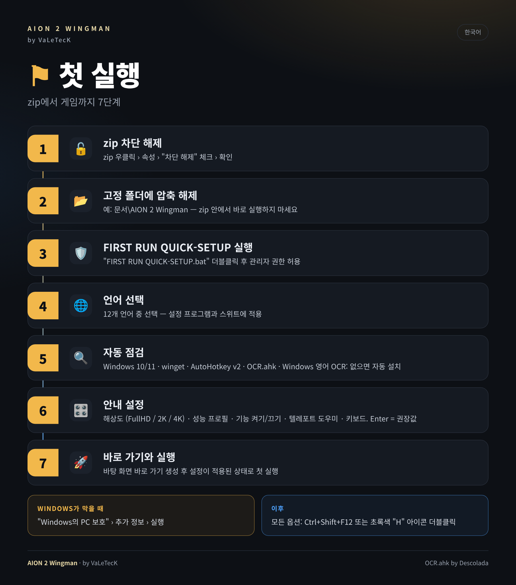 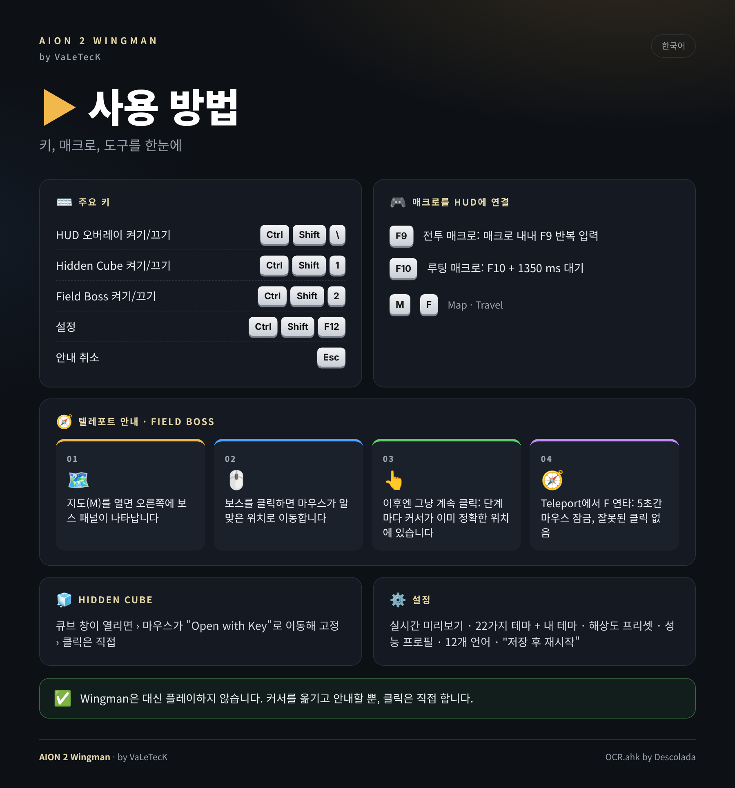

### ⌨️ 기본 키
`Ctrl+Shift+\` HUD · `Ctrl+Shift+1` Hidden Cube · `Ctrl+Shift+2` Field Boss · `Ctrl+Shift+F12` 설정 · `Esc` 안내 취소 · `F9` / `F10` 매크로 신호 (전투: F9 반복 입력, 루팅: F10 후 1350 ms 대기).

---

## 🇨🇳 简体中文

**AION 2 Wingman** 是一个用 **AutoHotkey v2** 编写的 Windows 程序，与 AION 2 同时运行，提供更清晰的 HUD 和一些实用的辅助功能。 这是一款**提升游戏体验（QoL）**的工具：更少的菜单、更少的点击，更多真正游戏的时间。

### 🛡️ 设计上就安全

AION 2 Wingman 是一个普通的 **AutoHotkey v2** 脚本：用记事本就能打开，逐行查看。

- ❌ **没有注入**：从不触碰游戏进程、内存或文件。
- ❌ **不读数据包，不是外挂机器人**：不读取也不修改网络流量，从不替你玩游戏。
- 👀 **只像你一样看屏幕**：地图截图由 Windows 内置 OCR 在本机读取。
- 🖱️ **每次点击都由你完成**：它移动光标，并在地图上用鼠标滚轮滚动列表和缩小视图。唯一的自动点击（Hidden Cube）**默认关闭**。
- 🔒 **没有遥测**：不发送任何游戏或个人数据。唯一的联网是在本 GitHub 页面检查更新，可以关闭。
- 🗂️ **一切都留在你的电脑上**（`%AppData%\AION 2 Wingman`）。
- 🧪 **经过 VirusTotal 扫描**：每个发布版本的说明中都附有 VirusTotal 扫描链接。
- 💚 **永久 100% 免费**：没有付费功能、没有隐藏功能、没有广告、无需账号。捐助完全自愿，不会解锁任何内容。

> ⚠️ 这是非官方的第三方工具：没有人能保证外部程序在游戏规则和反作弊面前完全零风险，请在遵守游戏服务条款的前提下谨慎使用。

### ⚡ 核心功能：前往任意 Field Boss 的快速传送助手

**从地图到首领只需 3 步**（ULTRA-FAST MODE，默认）：

1. 在 Field Boss 面板中**点击首领**（按 `M` 打开地图）。
2. **点击 Teleport**：Wingman 已在左侧 Kibelisk 列表中找到该首领的 Teleport，自动滚动过去并把光标放在上面。
3. **按两次 `F`**，然后跟随指向首领的**飞行方向**箭头。

完整引导路线 **NORMAL MODE** 仍可在设置中一键选择：

通常要前往 Field Boss，你需要打开地图、进入 Exploration 再进入 Field Boss、在长长的列表中找首领、找到最近的 Teleport，再朝正确方向飞行。**Wingman 把这些变成几次有引导的点击：**

1. **打开地图**（`M`）：面板按 A–Z 列出所有首领，显示品级、状态和重要度。
2. 在面板中**点击一个首领**。
3. Wingman **一步步引导光标**到 *Exploration*、*Field Boss*、*首领*，然后是它在地图上自动找到的**最近的 Teleport**。屏幕上的大号提示和目标点上的圆环会告诉你点哪里。
4. **按 `F`**（Travel）：箭头会显示前往首领的**飞行方向**。
5. 随时按 `Esc` 取消。在副本中面板会隐藏。

⚡ **为速度而设计。** 选好首领后无需瞄准、无需阅读：**只管连续点击左键**。每一步光标都已在正确位置，步骤之间的多余点击会被拦截。点击 Teleport 后，**连按 `F`**：鼠标会锁定几秒，任何误点都不会耽误出发。

🚀 **ULTRA-FAST MODE 详解。** Wingman 会自动滚动 Kibelisk 列表直到找到 Teleport。大多数首领的飞行方向已预先设置，否则根据离 Teleport 最近的首领图标计算，也可在首领列表中为每个首领修改。在 *设置 > Field Boss > 搜索与 Teleport* 中切换模式；Home 页面会显示当前模式。

### ✨ 功能
- **🎯 HUD 叠加层：**
  - 准星、两条横条，以及随宏信号（F9 / F10）点亮的 **LOOT** / **COMBAT** 图标；
  - 每个图标都有独立的形状、大小、位置、文字、表情和动画效果，也可以与另一个图标镜像对称；
  - 文字和表情会自动适配图标形状。
- **👑 Field Boss：**
  - 地图上显示所有首领的面板，带品级、状态和筛选；
  - **分步引导**你到最近的 Teleport，Travel 后显示**飞行方向**；
  - 在**副本**中面板不会出现。
- **🧊 Hidden Cube：** 窗口打开时把鼠标移到 "Open with Key"。
- **⚙️ 设置**（Ctrl+Shift+F12）：
  - **主页**一键开关各项功能；**基础**模式（只显示要点）与**高级**模式（全部选项）；关闭 AION 2 时自动退出（可关闭）；
  - 搜索、**实时预览**、分辨率预设（FullHD / 2K / 4K）、性能配置和自定义预设；
  - 维护菜单和**退出 Wingman**按钮；
  - **12 种语言**。
- **🎨 主题：**
  - **22 个预设主题**：经典主题、**8 个 AION 2 职业主题**和 **7 个节日主题**（万圣节、圣诞节、新年、情人节、狂欢节、复活节、圣帕特里克节）；
  - **主题编辑器**："自定义此主题"会生成你自己的 "… Custom" 副本，每个细节都能修改。
- **🔄 更新：** 检查并安装新版本，游戏时绝不打扰。设置、预设和主题（`%AppData%\AION 2 Wingman`）**会被保留**。

### 🎛️ 一切皆可自定义

HUD 和工具的每一个元素都能按你的喜好调整**外观**和**行为**：240 多个选项，每个都有说明、示例和实时预览，无需改代码。
- **准星**：形状（开/关分别设置）、数量、大小、粗细、间距、动画和速度。
- **横条**和 **LOOT / COMBAT 图标**：形状、大小、边框、位置、文字、表情、颜色、效果和淡入淡出，各自独立。
- **Field Boss 与辅助传送**：面板大小和位置、筛选、首领列表编辑器、引导方式、Teleport 后锁定鼠标、方向箭头、Teleport 搜索、副本列表。
- **Hidden Cube**、**按键**、**主题**、**语言**、**性能配置**和**预设**。

### 💻 系统要求
- Windows 10 或 11
- AutoHotkey v2 和 Windows 英语 OCR（由安装程序安装）
- 英文版 AION 2 客户端

### 🚀 安装与首次运行：从 FIRST RUN QUICK-SETUP 开始

> **解压 zip 后，请先双击 `FIRST RUN QUICK-SETUP.bat`。** 它就是安装包主文件夹中名字带有 "QUICK-SETUP" 的文件。
>
> FIRST RUN QUICK-SETUP 会安装 Wingman 完整运行所需的一切（AutoHotkey v2、Windows OCR、OCR 库），并引导你完成简短的初始设置：语言、分辨率、性能、主题、功能开关和键盘。最后它会创建桌面快捷方式，并以设置好的状态启动 Wingman。

1. 从[最新发布](../../releases/latest)下载 **`AION-2-Wingman.zip`**。
2. 右键 > **属性** > 勾选**解除锁定** > 确定。
3. 解压到固定文件夹（不要在 zip 里直接运行）。
4. 双击 **`FIRST RUN QUICK-SETUP.bat`** 并允许管理员权限。
5. 按向导完成设置（回车 = 推荐选项）。
6. 之后用快捷方式或 **`AION 2 Wingman.ahk`** 启动。可在 *设置 > 🛠️ 维护* 中重新运行 FIRST RUN QUICK-SETUP。

### 📖 快速指南

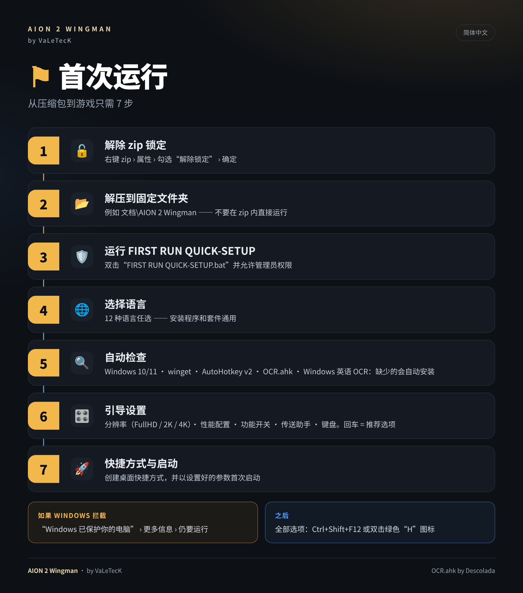 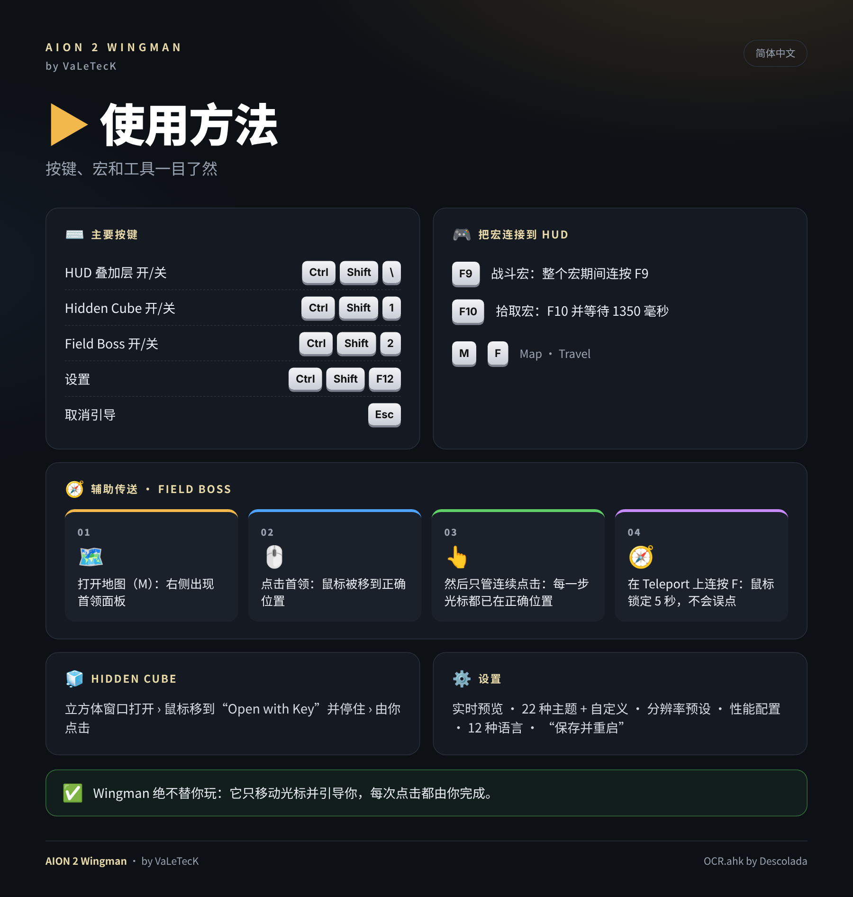

### ⌨️ 默认按键
`Ctrl+Shift+\` HUD · `Ctrl+Shift+1` Hidden Cube · `Ctrl+Shift+2` Field Boss · `Ctrl+Shift+F12` 设置 · `Esc` 取消引导 · `F9` / `F10` 宏信号（战斗：连续按 F9；拾取：F10 后等待 1350 毫秒）。

---

## 🇯🇵 日本語

**AION 2 Wingman** は **AutoHotkey v2** で作られた Windows プログラムです。AION 2 と一緒に動き、見やすい HUD と便利な補助機能を追加します。 **快適さ（QoL）を上げる**ツールです：メニューもクリックも減らして、遊ぶ時間を増やします。

### 🛡️ 仕組みからして安全

AION 2 Wingman はシンプルな **AutoHotkey v2** スクリプトです。メモ帳で開いて全行を確認できます。

- ❌ **インジェクションなし**：ゲームのプロセス・メモリ・ファイルには一切触れません。
- ❌ **パケットを読まない、ボットではない**：通信を読み取ったり書き換えたりせず、代わりにプレイすることもありません。
- 👀 **あなたと同じように画面を見るだけ**：マップの画面は Windows 内蔵 OCR が PC 上でローカルに読み取ります。
- 🖱️ **クリックはすべてご自身で**：カーソルを動かし、マップではマウスホイールでリストをスクロールしズームアウトします。唯一の自動クリック（Hidden Cube）は**初期状態でオフ**です。
- 🔒 **テレメトリなし**：ゲームや個人のデータは送信しません。唯一の通信はこの GitHub ページでのアップデート確認で、オフにできます。
- 🗂️ **すべてあなたの PC に保存**（`%AppData%\AION 2 Wingman`）。
- 🧪 **VirusTotal でスキャン済み**：各リリースのノートに VirusTotal の結果リンクがあります。
- 💚 **ずっと 100% 無料**：有料機能・隠し機能・広告・アカウントは一切ありません。寄付は完全に任意で、何も解放されません。

> ⚠️ 非公式のサードパーティ製ツールです。外部プログラムがゲームの規約やアンチチートに対して完全にノーリスクだと保証できる人はいません。利用規約を守り、理解したうえでご利用ください。

### ⚡ 目玉機能：どの Field Boss へも行ける高速テレポートアシスタント

**マップからボスまで 3 ステップ**（ULTRA-FAST MODE、デフォルト）：

1. Field Boss パネルで**ボスをクリック**（`M` でマップを開く）。
2. **Teleport をクリック**：Wingman が左の Kibelisk リストでボスの Teleport をすでに見つけ、スクロールしてカーソルを合わせています。
3. **`F` を 2 回**押して、ボスへの**飛行方向**の矢印に従うだけ。

完全なガイド付きルートの **NORMAL MODE** も、設定からワンクリックで選べます：

普段は Field Boss に行くために、マップを開き、Exploration から Field Boss へ進み、長いリストからボスを探し、最寄りの Teleport を見つけて正しい方向へ飛ぶ必要があります。**Wingman はこれを数回のガイド付きクリックにします：**

1. **マップを開く**（`M`）：パネルに全ボスが A–Z 順でグレード・状態・重要度とともに表示されます。
2. パネルで**ボスをクリック**。
3. Wingman が *Exploration*、*Field Boss*、*ボス*、そしてマップ上で自動で見つけた**最寄りの Teleport** へ、**カーソルを一歩ずつ案内**します。画面の大きな指示と正確な位置のリングがクリックする場所を示します。
4. **`F` を押す**（Travel）：矢印がボスへの**飛行方向**を示します。
5. `Esc` でいつでもキャンセル。ダンジョンではパネルは表示されません。

⚡ **スピード重視の設計。** ボスを選んだら、狙うことも読むことも不要です：**左クリックを連打するだけ**。各ステップでカーソルはすでに正しい位置にあり、ステップ間の余計なクリックはブロックされます。Teleport をクリックしたら **`F` を連打**。数秒間マウスがロックされるので、誤クリックで出発が邪魔されることはありません。

🚀 **ULTRA-FAST MODE の詳細。** Wingman は Teleport が見つかるまで Kibelisk リストを自動でスクロールします。飛行方向はほとんどのボスで設定済みで、未設定なら Teleport に最も近いボスアイコンから計算し、ボスリストでボスごとに変更できます。モードは *設定 > Field Boss > 検索と Teleport* で切り替え、Home に現在のモードが表示されます。

### ✨ 機能
- **🎯 HUD オーバーレイ：**
  - 照準、2 本のバー、マクロの信号（F9 / F10）で点灯する **LOOT** / **COMBAT** アイコン；
  - アイコンごとに形・サイズ・位置・テキスト・絵文字・アニメーション効果を個別に設定でき、左右対称にもできます；
  - テキストと絵文字はアイコンの形に自動で収まります。
- **👑 Field Boss：**
  - マップ上の全ボスをグレード・状態・フィルター付きで表示するパネル；
  - 最寄りの Teleport までの**手順ガイド**と、Travel 後の**飛行方向**；
  - **ダンジョン**ではパネルを表示しません。
- **🧊 Hidden Cube：** ウィンドウが開くとマウスを「Open with Key」へ移動します。
- **⚙️ 設定**（Ctrl+Shift+F12）：
  - 各機能をワンクリックでオン/オフできる**ホーム**画面、**基本**モード（要点のみ）と**詳細**モード（全オプション）、AION 2 を閉じると自動終了（オフ可）；
  - 検索、**ライブプレビュー**、解像度プリセット（FullHD / 2K / 4K）、パフォーマンスプロファイル、自作プリセット；
  - メンテナンスメニューと **Wingman を終了** ボタン；
  - **12 言語**。
- **🎨 テーマ：**
  - **22 種類の既成テーマ**：定番、**AION 2 のクラス 8 種**、**イベント 7 種**（ハロウィン、クリスマス、お正月、バレンタイン、カーニバル、イースター、聖パトリックの日）；
  - **テーマエディター**：「このテーマをカスタマイズ」で、細部まで変更できる自分のコピー「… Custom」が作られます。
- **🔄 アップデート：** プレイ中は邪魔せずに新しいリリースを確認・インストールします。設定・プリセット・テーマ（`%AppData%\AION 2 Wingman`）は**そのまま残ります**。

### 🎛️ すべてを自由にカスタマイズ

HUD とツールのあらゆる要素を、**見た目**も**動作**も好みに合わせて調整できます。240 以上のオプションに説明・例・ライブプレビューがあり、コードに触れる必要はありません。
- **照準**：形（オン/オフ別）、数、サイズ、太さ、間隔、アニメーションと速度。
- **バー**と **LOOT / COMBAT アイコン**：形、サイズ、枠、位置、テキスト、絵文字、色、エフェクト、フェードをそれぞれ個別に。
- **Field Boss とテレポートアシスト**：パネルのサイズと位置、フィルター、ボスリスト編集、ガイドの動作、Teleport 後のマウスロック、方向矢印、Teleport 検索、ダンジョンリスト。
- **Hidden Cube**、**キー**、**テーマ**、**言語**、**パフォーマンス**、**プリセット**。

### 💻 動作環境
- Windows 10 または 11
- AutoHotkey v2 と Windows の英語 OCR（セットアップがインストール）
- 英語版 AION 2 クライアント

### 🚀 インストールと初回起動：まず FIRST RUN QUICK-SETUP から

> **zip を展開したら、最初に `FIRST RUN QUICK-SETUP.bat` をダブルクリックしてください。** パッケージのメインフォルダーにある、名前に "QUICK-SETUP" が付いたファイルです。
>
> FIRST RUN QUICK-SETUP は Wingman を完全に動かすために必要なもの（AutoHotkey v2、Windows の OCR、OCR ライブラリ）をすべてインストールし、言語・解像度・パフォーマンス・テーマ・機能のオン/オフ・キーボードの初期設定を案内します。最後にショートカットを作り、設定済みの Wingman を起動します。

1. [最新リリース](../../releases/latest)から **`AION-2-Wingman.zip`** をダウンロード。
2. 右クリック > **プロパティ** > **許可する** にチェック > OK。
3. 固定のフォルダーに展開（zip の中から実行しないでください）。
4. **`FIRST RUN QUICK-SETUP.bat`** をダブルクリックし、管理者の確認を許可。
5. ガイドに従って設定（Enter = おすすめの選択）。
6. 以降はショートカットか **`AION 2 Wingman.ahk`** で起動。FIRST RUN QUICK-SETUP は *設定 > 🛠️ メンテナンス* からいつでも再実行できます。

### 📖 クイックガイド

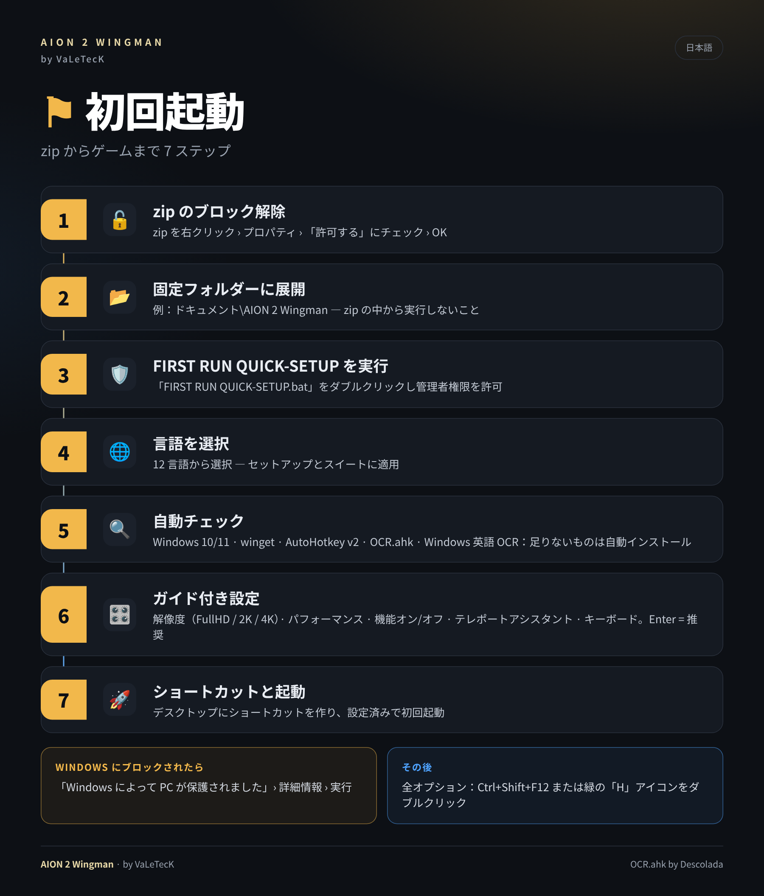 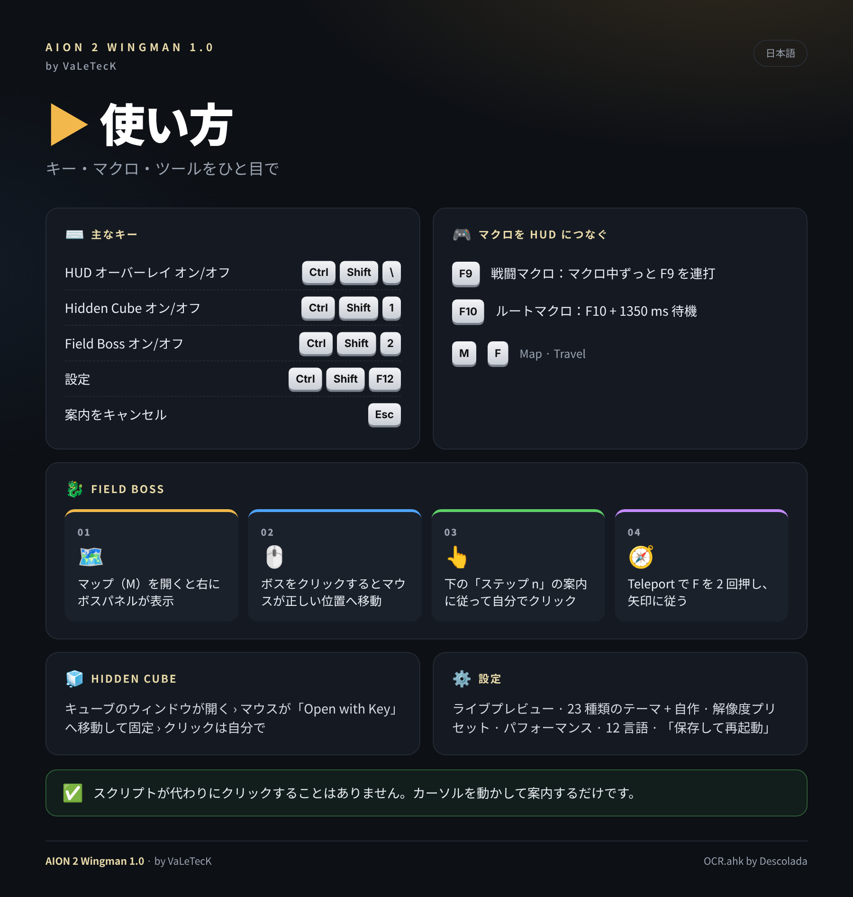

### ⌨️ 既定のキー
`Ctrl+Shift+\` HUD · `Ctrl+Shift+1` Hidden Cube · `Ctrl+Shift+2` Field Boss · `Ctrl+Shift+F12` 設定 · `Esc` ガイドを取消 · `F9` / `F10` マクロ信号（戦闘：F9 を連打、ルート：F10 のあと 1350 ms 待機）。

---

**AION 2 Wingman** — by VaLeTecK

### 💖 Support Wingman · Supporta Wingman

AION 2 Wingman is **100% free** and always will be: no paid or hidden features, and a donation unlocks nothing. If it saves you time, you can buy me a coffee with PayPal or Ko-fi (card payments, no PayPal account needed): every donation helps keep it updated.
AION 2 Wingman è **gratuito al 100%** e lo resterà: nessuna funzione a pagamento o nascosta, e una donazione non sblocca nulla. Se ti fa risparmiare tempo puoi offrirmi un caffè con PayPal o Ko-fi (anche con carta, senza account PayPal): ogni donazione aiuta a tenerlo aggiornato.

 

Also in the app: PayPal / Ko-fi buttons at the bottom of Settings · Anche nell'app: pulsanti PayPal / Ko-fi in fondo alle Impostazioni

---

OCR.ahk by [Descolada](https://github.com/Descolada/OCR) · Built with [AutoHotkey v2](https://www.autohotkey.com)

AION 2 is a trademark of its respective owners. This project is not affiliated with or endorsed by them. It is a third-party tool: use it at your own risk and within the game's terms of service.

